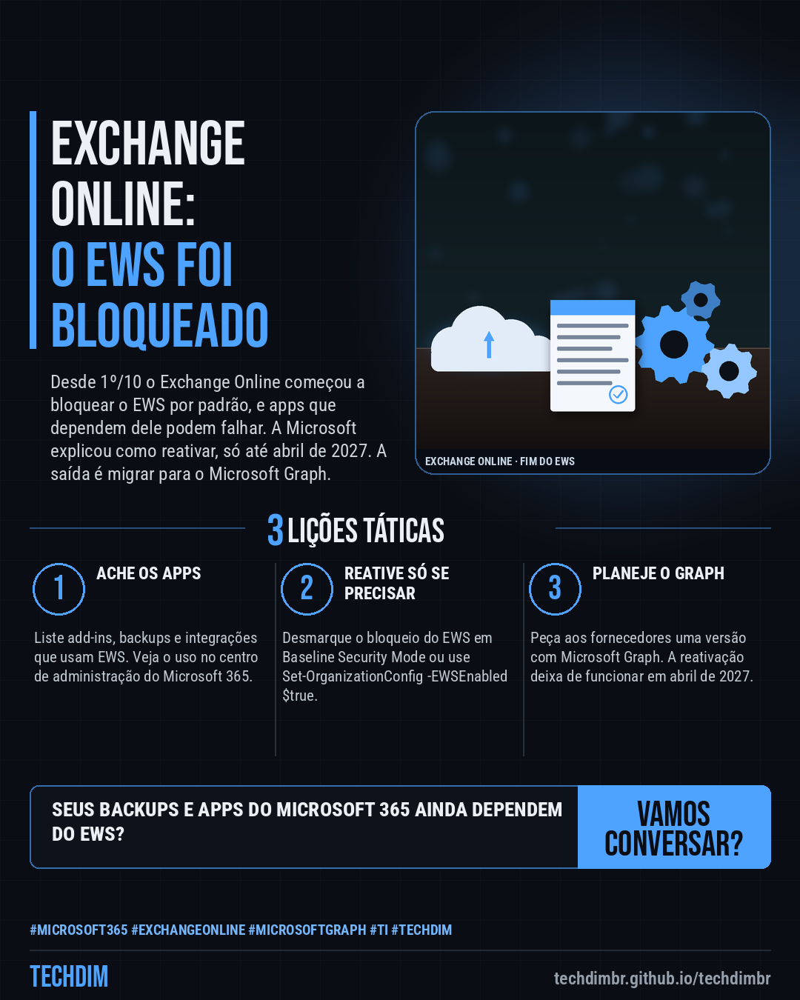
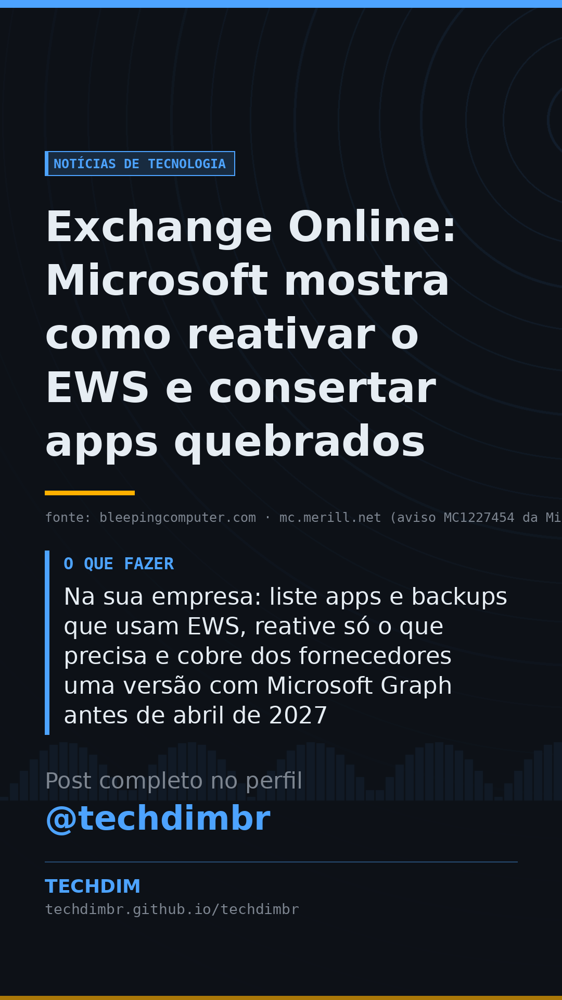

# Notícias de Tecnologia — Exchange Online: Microsoft mostra como reativar o EWS e consertar apps quebrados

- **Data:** 2026-10-23, 08:00 (horário de Brasília)
- **Curadoria:** Claude (Routine) — pauta do dia
- **Execução no Actions:** https://github.com/Techdimbr/Publi-midia-Techdim/actions/runs/39942884435
- **Por que esta pauta:** Mudança do Microsoft 365 que está quebrando add-ins e backups, com o passo a passo de reativação e o prazo final de abril de 2027 confirmados em duas fontes e no aviso da Microsoft.

## Resultado

| Rede | Status | Link | 1º comentário |
|---|---|---|---|
| linkedin | ✅ publicado | https://www.linkedin.com/feed/update/urn:li:share:7519351784499204096/ | — |
| facebook | ✅ publicado | https://www.facebook.com/122132402349390486/posts/122137968357390486 | ✅ |
| instagram | ✅ publicado | https://www.instagram.com/p/De1ZkLXjPBU/ | ✅ |
| Stories | ✅ publicado | https://www.instagram.com/stories/techdimbr/4014227184277020102 | — |

## Fontes

- [bleepingcomputer.com](https://www.bleepingcomputer.com/news/microsoft/microsoft-shares-how-to-fix-broken-exchange-online-ews-apps/)
- [mc.merill.net (aviso MC1227454 da Microsoft)](https://mc.merill.net/message/MC1227454)
- [veeam.com (KB4820)](https://www.veeam.com/kb4820)

## Linkedin

```text
Exchange Online: Microsoft mostra como reativar o EWS e consertar apps quebrados

01. Desde 1º/10 o Exchange Online começou a bloquear o EWS por padrão. Apps que dependem dele, como add-ins do Outlook, Apple Mail e backups, podem falhar ou pedir senha
02. A Microsoft explicou como reativar: em Baseline Security Mode, no centro de administração, ou com Set-OrganizationConfig -EWSEnabled $true. Só funciona até abril de 2027
03. Na sua empresa: liste apps e backups que usam EWS, reative só o que precisa e cobre dos fornecedores uma versão com Microsoft Graph antes de abril de 2027

Seus apps do Microsoft 365 pararam depois de 1º/10? Confira se dependem do EWS e peça aos fornecedores a versão com Graph.

Fontes: https://www.bleepingcomputer.com/news/microsoft/microsoft-shares-how-to-fix-broken-exchange-online-ews-apps/ · https://mc.merill.net/message/MC1227454

TECHDIM — Infraestrutura · Segurança · IA
https://techdimbr.github.io/techdimbr/

#Microsoft365 #ExchangeOnline #MicrosoftGraph #TI #TECHDIM
```



## Facebook

```text
Exchange Online: Microsoft mostra como reativar o EWS e consertar apps quebrados

• Desde 1º/10 o Exchange Online começou a bloquear o EWS por padrão. Apps que dependem dele, como add-ins do Outlook, Apple Mail e backups, podem falhar ou pedir senha
• A Microsoft explicou como reativar: em Baseline Security Mode, no centro de administração, ou com Set-OrganizationConfig -EWSEnabled $true. Só funciona até abril de 2027
• Na sua empresa: liste apps e backups que usam EWS, reative só o que precisa e cobre dos fornecedores uma versão com Microsoft Graph antes de abril de 2027

Seus apps do Microsoft 365 pararam depois de 1º/10? Confira se dependem do EWS e peça aos fornecedores a versão com Graph.

Fale com a TECHDIM — fontes e site no primeiro comentário 👇

#Microsoft365 #ExchangeOnline #MicrosoftGraph #TECHDIM
```

Primeiro comentário:

```text
📎 Fontes:
• bleepingcomputer.com: https://www.bleepingcomputer.com/news/microsoft/microsoft-shares-how-to-fix-broken-exchange-online-ews-apps/
• mc.merill.net (aviso MC1227454 da Microsoft): https://mc.merill.net/message/MC1227454
• veeam.com (KB4820): https://www.veeam.com/kb4820

🌐 TECHDIM — Infraestrutura · Segurança · IA: https://techdimbr.github.io/techdimbr/
```


## Instagram

```text
Exchange Online: Microsoft mostra como reativar o EWS e consertar apps quebrados

1️⃣ Desde 1º/10 o Exchange Online começou a bloquear o EWS por padrão. Apps que dependem dele, como add-ins do Outlook, Apple Mail e backups, podem falhar ou pedir senha
2️⃣ A Microsoft explicou como reativar: em Baseline Security Mode, no centro de administração, ou com Set-OrganizationConfig -EWSEnabled $true. Só funciona até abril de 2027
3️⃣ Na sua empresa: liste apps e backups que usam EWS, reative só o que precisa e cobre dos fornecedores uma versão com Microsoft Graph antes de abril de 2027

Seus apps do Microsoft 365 pararam depois de 1º/10? Confira se dependem do EWS e peça aos fornecedores a versão com Graph.

🔗 Link na bio: techdimbr.github.io/techdimbr
Fontes no primeiro comentário 👇

#microsoft365 #exchangeonline #microsoftgraph #ti #techdim #tecnologia #inteligenciaartificial #ia
```

Primeiro comentário:

```text
📎 Fontes: bleepingcomputer.com · mc.merill.net (aviso MC1227454 da Microsoft) · veeam.com (KB4820)
```


## Stories


