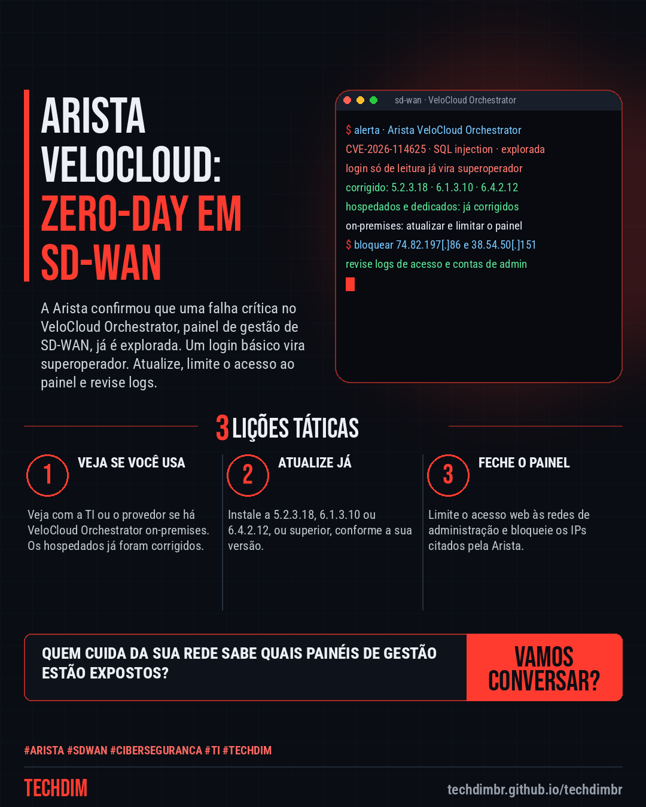
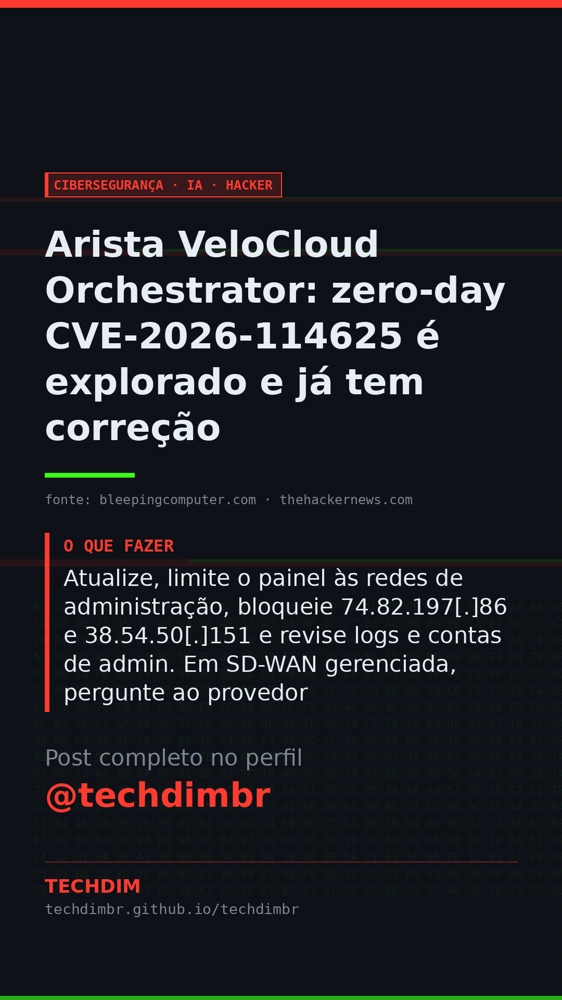

# Cibersegurança · IA · Hacker — Arista VeloCloud Orchestrator: zero-day CVE-2026-114625 é explorado e já tem correção

- **Data:** 2026-10-23, 11:11 (horário de Brasília)
- **Curadoria:** Claude (Routine) — pauta do dia
- **Execução no Actions:** https://github.com/Techdimbr/Publi-midia-Techdim/actions/runs/39967334821
- **Por que esta pauta:** Zero-day explorado em orquestrador de SD-WAN, com correção disponível e orientações do aviso da Arista confirmadas por duas fontes.

## Resultado

| Rede | Status | Link | 1º comentário |
|---|---|---|---|
| linkedin | ✅ publicado | https://www.linkedin.com/feed/update/urn:li:share:7519399905942200320/ | — |
| facebook | ✅ publicado | https://www.facebook.com/122132402349390486/posts/122138006127390486 | ✅ |
| instagram | ✅ publicado | https://www.instagram.com/p/De1vcqiFw23/ | ✅ |
| Stories | ✅ publicado | https://www.instagram.com/stories/techdimbr/4014323447656581438 | — |

## Fontes

- [bleepingcomputer.com](https://www.bleepingcomputer.com/news/security/arista-patches-new-velocloud-orchestrator-zero-day-exploited-in-attacks/)
- [thehackernews.com](https://thehackernews.com/2026/10/arista-warns-of-critical-velocloud-sql.html)

## Linkedin

```text
Arista VeloCloud Orchestrator: zero-day CVE-2026-114625 é explorado e já tem correção

01. A Arista alertou que a CVE-2026-114625, um SQL injection no VeloCloud Orchestrator, gerenciador de SD-WAN, está sendo explorada. Já há correção
02. Com um login de baixo privilégio, até só de leitura, o atacante vira superoperador do orquestrador. Corrigidas: 5.2.3.18, 6.1.3.10 e 6.4.2.12 ou superiores
03. Atualize, limite o painel às redes de administração, bloqueie 74.82.197[.]86 e 38.54.50[.]151 e revise logs e contas de admin. Em SD-WAN gerenciada, pergunte ao provedor

Sua empresa usa SD-WAN gerenciada? Pergunte ao provedor se o VeloCloud Orchestrator já foi atualizado e se o painel está restrito.

Fontes: https://www.bleepingcomputer.com/news/security/arista-patches-new-velocloud-orchestrator-zero-day-exploited-in-attacks/ · https://thehackernews.com/2026/10/arista-warns-of-critical-velocloud-sql.html

TECHDIM — Infraestrutura · Segurança · IA
https://techdimbr.github.io/techdimbr/

#Arista #Sdwan #Ciberseguranca #TI #TECHDIM
```



## Facebook

```text
Arista VeloCloud Orchestrator: zero-day CVE-2026-114625 é explorado e já tem correção

• A Arista alertou que a CVE-2026-114625, um SQL injection no VeloCloud Orchestrator, gerenciador de SD-WAN, está sendo explorada. Já há correção
• Com um login de baixo privilégio, até só de leitura, o atacante vira superoperador do orquestrador. Corrigidas: 5.2.3.18, 6.1.3.10 e 6.4.2.12 ou superiores
• Atualize, limite o painel às redes de administração, bloqueie 74.82.197[.]86 e 38.54.50[.]151 e revise logs e contas de admin. Em SD-WAN gerenciada, pergunte ao provedor

Sua empresa usa SD-WAN gerenciada? Pergunte ao provedor se o VeloCloud Orchestrator já foi atualizado e se o painel está restrito.

Fale com a TECHDIM — fontes e site no primeiro comentário 👇

#Arista #Sdwan #Ciberseguranca #TECHDIM
```

Primeiro comentário:

```text
📎 Fontes:
• bleepingcomputer.com: https://www.bleepingcomputer.com/news/security/arista-patches-new-velocloud-orchestrator-zero-day-exploited-in-attacks/
• thehackernews.com: https://thehackernews.com/2026/10/arista-warns-of-critical-velocloud-sql.html

🌐 TECHDIM — Infraestrutura · Segurança · IA: https://techdimbr.github.io/techdimbr/
```


## Instagram

```text
Arista VeloCloud Orchestrator: zero-day CVE-2026-114625 é explorado e já tem correção

1️⃣ A Arista alertou que a CVE-2026-114625, um SQL injection no VeloCloud Orchestrator, gerenciador de SD-WAN, está sendo explorada. Já há correção
2️⃣ Com um login de baixo privilégio, até só de leitura, o atacante vira superoperador do orquestrador. Corrigidas: 5.2.3.18, 6.1.3.10 e 6.4.2.12 ou superiores
3️⃣ Atualize, limite o painel às redes de administração, bloqueie 74.82.197[.]86 e 38.54.50[.]151 e revise logs e contas de admin. Em SD-WAN gerenciada, pergunte ao provedor

Sua empresa usa SD-WAN gerenciada? Pergunte ao provedor se o VeloCloud Orchestrator já foi atualizado e se o painel está restrito.

🔗 Link na bio: techdimbr.github.io/techdimbr
Fontes no primeiro comentário 👇

#arista #sdwan #ciberseguranca #ti #techdim #seguranca #hacker #infraestrutura
```

Primeiro comentário:

```text
📎 Fontes: bleepingcomputer.com · thehackernews.com
```


## Stories


