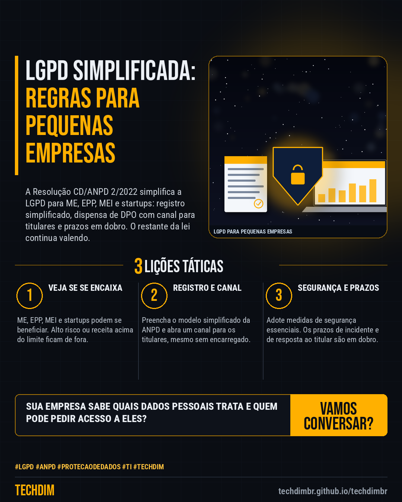

# Conhecimento — LGPD para pequenas empresas: o que a Resolução ANPD 2/2022 simplifica, em 5 passos

- **Data:** 2026-10-23, 14:24 (horário de Brasília)
- **Curadoria:** Claude (Routine) — pauta do dia
- **Execução no Actions:** https://github.com/Techdimbr/Publi-midia-Techdim/actions/runs/39994657795
- **Por que esta pauta:** Passo a passo prático baseado na Resolução CD/ANPD nº 2/2022, com o que ela simplifica para pequenas empresas e o que continua obrigatório; não substitui assessoria jurídica.

## Resultado

| Rede | Status | Link | 1º comentário |
|---|---|---|---|
| linkedin | ✅ publicado | https://www.linkedin.com/feed/update/urn:li:share:7519448536325836800/ | — |
| facebook | ✅ publicado | https://www.facebook.com/122132402349390486/posts/122138033805390486 | ✅ |
| instagram | ✅ publicado | https://www.instagram.com/p/De2Fkc8DTlJ/ | ✅ |

## Fontes

- [gov.br/anpd (Resolução CD/ANPD nº 2/2022)](https://www.gov.br/anpd/pt-br/acesso-a-informacao/institucional/atos-normativos/regulamentacoes_anpd/resolucao-cd-anpd-no-2-de-27-de-janeiro-de-2022)
- [gov.br/anpd (modelo de registro simplificado)](https://www.gov.br/anpd/pt-br/assuntos/noticias/anpd-divulga-modelo-de-registro-simplificado-de-operacoes-com-dados-pessoais-para-agentes-de-tratamento-de-pequeno-porte-atpp)

## Linkedin

```text
LGPD para pequenas empresas: o que a Resolução ANPD 2/2022 simplifica, em 5 passos

01. 1) Confira se sua empresa é agente de pequeno porte: ME, EPP, MEI ou startup (art. 2º), sem tratamento de alto risco nem receita acima do limite (art. 3º)
02. 2) Faça o registro simplificado das operações com dados pessoais (art. 9º), no modelo da ANPD. 3) Sem encarregado (DPO), abra um canal para os titulares (art. 11)
03. 4) Adote medidas de segurança essenciais (art. 12). 5) Prazos de resposta ao titular e de aviso de incidente valem em dobro (art. 14). O resto da LGPD continua valendo

Sua empresa tem registro simplificado dos dados pessoais e canal para os titulares? Comece por eles e confirme com seu advogado.

Fontes: https://www.gov.br/anpd/pt-br/acesso-a-informacao/institucional/atos-normativos/regulamentacoes_anpd/resolucao-cd-anpd-no-2-de-27-de-janeiro-de-2022 · https://www.gov.br/anpd/pt-br/assuntos/noticias/anpd-divulga-modelo-de-registro-simplificado-de-operacoes-com-dados-pessoais-para-agentes-de-tratamento-de-pequeno-porte-atpp

TECHDIM — Infraestrutura · Segurança · IA
https://techdimbr.github.io/techdimbr/

#Lgpd #Anpd #ProtecaoDeDados #TI #TECHDIM
```



## Facebook

```text
LGPD para pequenas empresas: o que a Resolução ANPD 2/2022 simplifica, em 5 passos

• 1) Confira se sua empresa é agente de pequeno porte: ME, EPP, MEI ou startup (art. 2º), sem tratamento de alto risco nem receita acima do limite (art. 3º)
• 2) Faça o registro simplificado das operações com dados pessoais (art. 9º), no modelo da ANPD. 3) Sem encarregado (DPO), abra um canal para os titulares (art. 11)
• 4) Adote medidas de segurança essenciais (art. 12). 5) Prazos de resposta ao titular e de aviso de incidente valem em dobro (art. 14). O resto da LGPD continua valendo

Sua empresa tem registro simplificado dos dados pessoais e canal para os titulares? Comece por eles e confirme com seu advogado.

Fale com a TECHDIM — fontes e site no primeiro comentário 👇

#Lgpd #Anpd #ProtecaoDeDados #TECHDIM
```

Primeiro comentário:

```text
📎 Fontes:
• gov.br/anpd (Resolução CD/ANPD nº 2/2022): https://www.gov.br/anpd/pt-br/acesso-a-informacao/institucional/atos-normativos/regulamentacoes_anpd/resolucao-cd-anpd-no-2-de-27-de-janeiro-de-2022
• gov.br/anpd (modelo de registro simplificado): https://www.gov.br/anpd/pt-br/assuntos/noticias/anpd-divulga-modelo-de-registro-simplificado-de-operacoes-com-dados-pessoais-para-agentes-de-tratamento-de-pequeno-porte-atpp

🌐 TECHDIM — Infraestrutura · Segurança · IA: https://techdimbr.github.io/techdimbr/
```


## Instagram

```text
LGPD para pequenas empresas: o que a Resolução ANPD 2/2022 simplifica, em 5 passos

1️⃣ 1) Confira se sua empresa é agente de pequeno porte: ME, EPP, MEI ou startup (art. 2º), sem tratamento de alto risco nem receita acima do limite (art. 3º)
2️⃣ 2) Faça o registro simplificado das operações com dados pessoais (art. 9º), no modelo da ANPD. 3) Sem encarregado (DPO), abra um canal para os titulares (art. 11)
3️⃣ 4) Adote medidas de segurança essenciais (art. 12). 5) Prazos de resposta ao titular e de aviso de incidente valem em dobro (art. 14). O resto da LGPD continua valendo

Sua empresa tem registro simplificado dos dados pessoais e canal para os titulares? Comece por eles e confirme com seu advogado.

🔗 Link na bio: techdimbr.github.io/techdimbr
Fontes no primeiro comentário 👇

#lgpd #anpd #protecaodedados #ti #techdim #conhecimento #aprendati #tecnologia
```

Primeiro comentário:

```text
📎 Fontes: gov.br/anpd (Resolução CD/ANPD nº 2/2022) · gov.br/anpd (modelo de registro simplificado)
```


