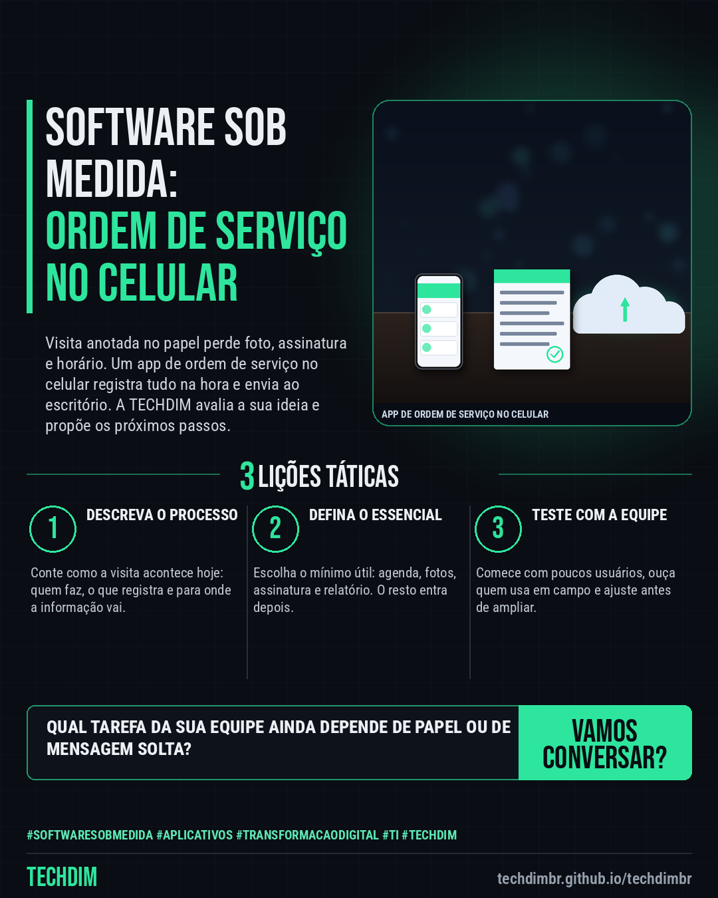

# TECHDIM · Serviços — Software sob medida: aplicativo de ordem de serviço no celular para sua equipe de campo

- **Data:** 2026-10-23, 17:25 (horário de Brasília)
- **Curadoria:** Claude (Routine) — pauta do dia
- **Execução no Actions:** https://github.com/Techdimbr/Publi-midia-Techdim/actions/runs/40018905326
- **Por que esta pauta:** Apresenta o serviço de software sob medida com uma ideia de projeto concreta (ordem de serviço no celular), convidando o leitor a contar o processo, sem promessa de preço, prazo ou resultado.

## Resultado

| Rede | Status | Link | 1º comentário |
|---|---|---|---|
| linkedin | ✅ publicado | https://www.linkedin.com/feed/update/urn:li:share:7519493975389474817/ | — |
| facebook | ✅ publicado | https://www.facebook.com/122132402349390486/posts/122138060073390486 | ✅ |
| instagram | ✅ publicado | https://www.instagram.com/p/De2aPf8o7Pf/ | — |

## Linkedin

```text
Software sob medida: aplicativo de ordem de serviço no celular para sua equipe de campo

01. Equipe externa que anota visita no papel perde foto, assinatura e horário. Um app de ordem de serviço no celular registra tudo na hora e envia para o escritório
02. A TECHDIM desenvolve sistemas e apps sob medida para web, desktop e celular, com itens como agenda de visitas, fotos, assinatura e relatórios, conforme o seu processo
03. Conte como é o seu processo hoje. A TECHDIM avalia se faz sentido virar sistema ou app e propõe os próximos passos, sem compromisso e sem prometer prazo

Qual tarefa da sua equipe ainda é feita no papel ou em mensagem solta? Conte a ideia para a TECHDIM: techdimbr.github.io/techdimbr

TECHDIM — Infraestrutura · Segurança · IA
https://techdimbr.github.io/techdimbr/

#SoftwareSobMedida #Aplicativos #TransformacaoDigital #TI #TECHDIM
```



## Facebook

```text
Software sob medida: aplicativo de ordem de serviço no celular para sua equipe de campo

• Equipe externa que anota visita no papel perde foto, assinatura e horário. Um app de ordem de serviço no celular registra tudo na hora e envia para o escritório
• A TECHDIM desenvolve sistemas e apps sob medida para web, desktop e celular, com itens como agenda de visitas, fotos, assinatura e relatórios, conforme o seu processo
• Conte como é o seu processo hoje. A TECHDIM avalia se faz sentido virar sistema ou app e propõe os próximos passos, sem compromisso e sem prometer prazo

Qual tarefa da sua equipe ainda é feita no papel ou em mensagem solta? Conte a ideia para a TECHDIM: techdimbr.github.io/techdimbr

Fale com a TECHDIM — link no primeiro comentário 👇

#SoftwareSobMedida #Aplicativos #TransformacaoDigital #TECHDIM
```

Primeiro comentário:

```text
🌐 TECHDIM — Infraestrutura · Segurança · IA: https://techdimbr.github.io/techdimbr/
```


## Instagram

```text
Software sob medida: aplicativo de ordem de serviço no celular para sua equipe de campo

1️⃣ Equipe externa que anota visita no papel perde foto, assinatura e horário. Um app de ordem de serviço no celular registra tudo na hora e envia para o escritório
2️⃣ A TECHDIM desenvolve sistemas e apps sob medida para web, desktop e celular, com itens como agenda de visitas, fotos, assinatura e relatórios, conforme o seu processo
3️⃣ Conte como é o seu processo hoje. A TECHDIM avalia se faz sentido virar sistema ou app e propõe os próximos passos, sem compromisso e sem prometer prazo

Qual tarefa da sua equipe ainda é feita no papel ou em mensagem solta? Conte a ideia para a TECHDIM: techdimbr.github.io/techdimbr

🔗 Link na bio: techdimbr.github.io/techdimbr

#softwaresobmedida #aplicativos #transformacaodigital #ti #techdim #suportetecnico #ciberseguranca #automacao
```


