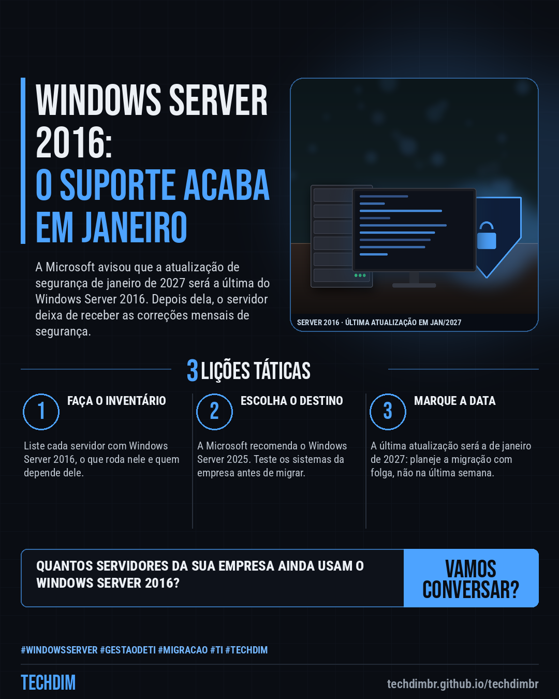

# Notícias de Tecnologia — Windows Server 2016: Microsoft avisa que a atualização de janeiro de 2027 será a última

- **Data:** 2026-10-24, 07:59 (horário de Brasília)
- **Curadoria:** Claude (Routine) — pauta do dia
- **Execução no Actions:** https://github.com/Techdimbr/Publi-midia-Techdim/actions/runs/40088016256
- **Por que esta pauta:** Notícia de 23/10 confirmada no BleepingComputer e na página de ciclo de vida da Microsoft: o Windows Server 2016 recebe a última atualização de segurança em janeiro de 2027, com impacto direto em servidores de pequenas e médias empresas.

## Resultado

| Rede | Status | Link | 1º comentário |
|---|---|---|---|
| linkedin | ✅ publicado | https://www.linkedin.com/feed/update/urn:li:share:7519714052240027648/ | — |
| facebook | ✅ publicado | https://www.facebook.com/122132402349390486/posts/122138171367390486 | ✅ |
| instagram | ✅ publicado | https://www.instagram.com/p/De3-Tbaj8bK/ | ✅ |
| Stories | ✅ publicado | https://www.instagram.com/stories/techdimbr/4014951731158672901 | — |

## Fontes

- [bleepingcomputer.com](https://www.bleepingcomputer.com/news/microsoft/microsoft-windows-server-2016-reaches-end-of-support-in-january/)
- [learn.microsoft.com](https://learn.microsoft.com/en-us/lifecycle/products/windows-server-2016)

## Linkedin

```text
Windows Server 2016: Microsoft avisa que a atualização de janeiro de 2027 será a última

01. A Microsoft confirmou que a atualização de segurança de janeiro de 2027 será a última do Windows Server 2016, em todas as edições, inclusive a Essentials
02. Depois disso, o sistema deixa de receber as atualizações mensais de segurança. O suporte aos recursos exclusivos do Essentials, como o Remote Web Access, também termina
03. Na sua empresa: liste os servidores com Windows Server 2016 e planeje a migração. A Microsoft recomenda o Windows Server 2025, com teste gratuito de 180 dias

Quantos servidores da sua empresa ainda rodam Windows Server 2016? Faça o levantamento agora, para migrar sem correria.

Fontes: https://www.bleepingcomputer.com/news/microsoft/microsoft-windows-server-2016-reaches-end-of-support-in-january/ · https://learn.microsoft.com/en-us/lifecycle/products/windows-server-2016

TECHDIM — Infraestrutura · Segurança · IA
https://techdimbr.github.io/techdimbr/

#WindowsServer #GestaoDeTI #Migracao #TI #TECHDIM
```



## Facebook

```text
Windows Server 2016: Microsoft avisa que a atualização de janeiro de 2027 será a última

• A Microsoft confirmou que a atualização de segurança de janeiro de 2027 será a última do Windows Server 2016, em todas as edições, inclusive a Essentials
• Depois disso, o sistema deixa de receber as atualizações mensais de segurança. O suporte aos recursos exclusivos do Essentials, como o Remote Web Access, também termina
• Na sua empresa: liste os servidores com Windows Server 2016 e planeje a migração. A Microsoft recomenda o Windows Server 2025, com teste gratuito de 180 dias

Quantos servidores da sua empresa ainda rodam Windows Server 2016? Faça o levantamento agora, para migrar sem correria.

Fale com a TECHDIM — fontes e site no primeiro comentário 👇

#WindowsServer #GestaoDeTI #Migracao #TECHDIM
```

Primeiro comentário:

```text
📎 Fontes:
• bleepingcomputer.com: https://www.bleepingcomputer.com/news/microsoft/microsoft-windows-server-2016-reaches-end-of-support-in-january/
• learn.microsoft.com: https://learn.microsoft.com/en-us/lifecycle/products/windows-server-2016

🌐 TECHDIM — Infraestrutura · Segurança · IA: https://techdimbr.github.io/techdimbr/
```


## Instagram

```text
Windows Server 2016: Microsoft avisa que a atualização de janeiro de 2027 será a última

1️⃣ A Microsoft confirmou que a atualização de segurança de janeiro de 2027 será a última do Windows Server 2016, em todas as edições, inclusive a Essentials
2️⃣ Depois disso, o sistema deixa de receber as atualizações mensais de segurança. O suporte aos recursos exclusivos do Essentials, como o Remote Web Access, também termina
3️⃣ Na sua empresa: liste os servidores com Windows Server 2016 e planeje a migração. A Microsoft recomenda o Windows Server 2025, com teste gratuito de 180 dias

Quantos servidores da sua empresa ainda rodam Windows Server 2016? Faça o levantamento agora, para migrar sem correria.

🔗 Link na bio: techdimbr.github.io/techdimbr
Fontes no primeiro comentário 👇

#windowsserver #gestaodeti #migracao #ti #techdim #tecnologia #inteligenciaartificial #ia
```

Primeiro comentário:

```text
📎 Fontes: bleepingcomputer.com · learn.microsoft.com
```


## Stories


