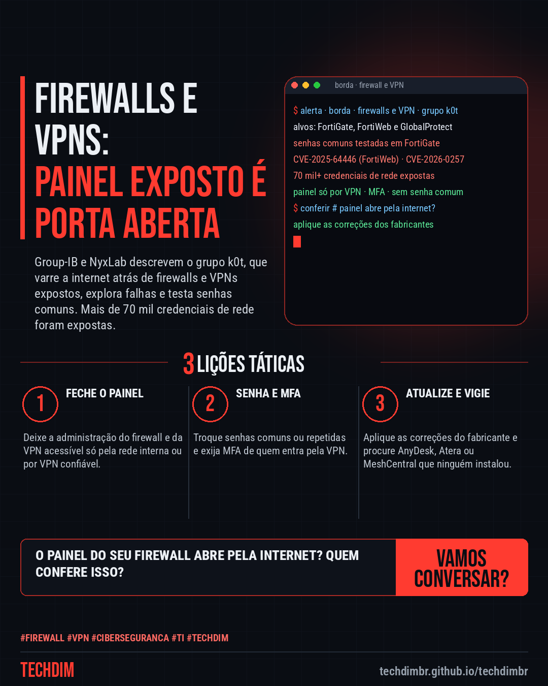
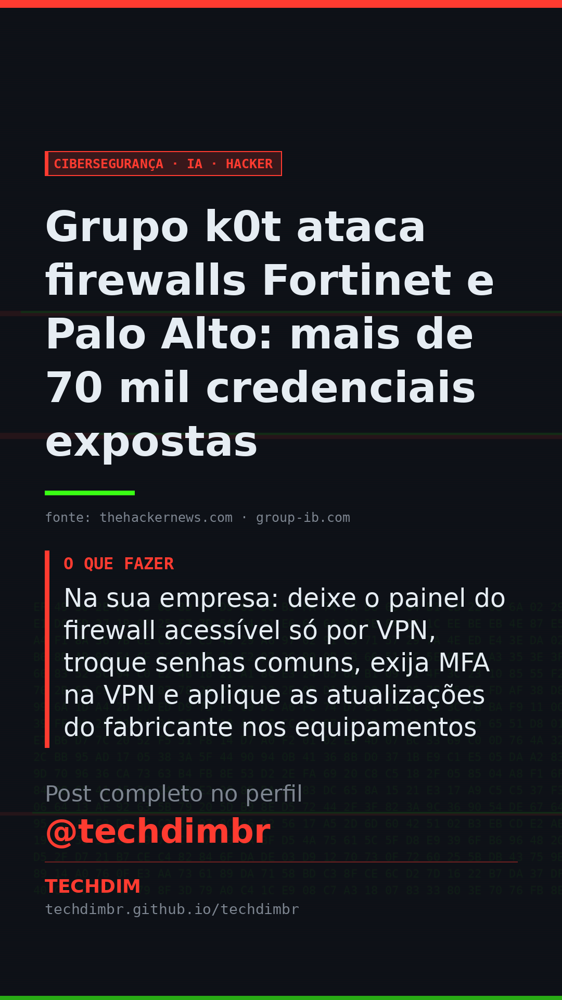

# Cibersegurança · IA · Hacker — Grupo k0t ataca firewalls Fortinet e Palo Alto: mais de 70 mil credenciais expostas

- **Data:** 2026-10-24, 11:09 (horário de Brasília)
- **Curadoria:** Claude (Routine) — pauta do dia
- **Execução no Actions:** https://github.com/Techdimbr/Publi-midia-Techdim/actions/runs/40101135600
- **Por que esta pauta:** Campanha contra firewalls e VPNs, equipamentos comuns em pequenas e médias empresas: o relatório do Group-IB e da NyxLab saiu em 21/10 e o The Hacker News o repercutiu em 23/10, com orientações práticas de mitigação.

## Resultado

| Rede | Status | Link | 1º comentário |
|---|---|---|---|
| linkedin | ✅ publicado | https://www.linkedin.com/feed/update/urn:li:share:7519761762104000512/ | — |
| facebook | ✅ publicado | https://www.facebook.com/122132402349390486/posts/122138198511390486 | ✅ |
| instagram | ✅ publicado | https://www.instagram.com/p/De4UAp8mGvr/ | ✅ |
| Stories | ✅ publicado | https://www.instagram.com/stories/techdimbr/4015047226846397096 | — |

## Fontes

- [thehackernews.com](https://thehackernews.com/2026/10/hackers-breach-enterprise-firewalls-and.html)
- [group-ib.com](https://www.group-ib.com/blog/stray-cat-network-edge/)
- [security.paloaltonetworks.com (CVE-2026-0257)](https://security.paloaltonetworks.com/CVE-2026-0257)

## Linkedin

```text
Grupo k0t ataca firewalls Fortinet e Palo Alto: mais de 70 mil credenciais expostas

01. Group-IB e NyxLab descrevem o grupo k0t, que procura firewalls e VPNs expostos na internet. Mais de 70 mil credenciais de equipamentos de rede foram expostas
02. Ele explora falhas do FortiWeb (CVE-2025-64446) e do GlobalProtect da Palo Alto (CVE-2026-0257) e testa senhas comuns em FortiGate. A Palo Alto já tem correção
03. Na sua empresa: deixe o painel do firewall acessível só por VPN, troque senhas comuns, exija MFA na VPN e aplique as atualizações do fabricante nos equipamentos

O painel do seu firewall ou da sua VPN abre pela internet? Peça ao seu suporte de TI para conferir hoje e fechar esse acesso.

Fontes: https://thehackernews.com/2026/10/hackers-breach-enterprise-firewalls-and.html · https://www.group-ib.com/blog/stray-cat-network-edge/

TECHDIM — Infraestrutura · Segurança · IA
https://techdimbr.github.io/techdimbr/

#Firewall #VPN #Ciberseguranca #TI #TECHDIM
```



## Facebook

```text
Grupo k0t ataca firewalls Fortinet e Palo Alto: mais de 70 mil credenciais expostas

• Group-IB e NyxLab descrevem o grupo k0t, que procura firewalls e VPNs expostos na internet. Mais de 70 mil credenciais de equipamentos de rede foram expostas
• Ele explora falhas do FortiWeb (CVE-2025-64446) e do GlobalProtect da Palo Alto (CVE-2026-0257) e testa senhas comuns em FortiGate. A Palo Alto já tem correção
• Na sua empresa: deixe o painel do firewall acessível só por VPN, troque senhas comuns, exija MFA na VPN e aplique as atualizações do fabricante nos equipamentos

O painel do seu firewall ou da sua VPN abre pela internet? Peça ao seu suporte de TI para conferir hoje e fechar esse acesso.

Fale com a TECHDIM — fontes e site no primeiro comentário 👇

#Firewall #VPN #Ciberseguranca #TECHDIM
```

Primeiro comentário:

```text
📎 Fontes:
• thehackernews.com: https://thehackernews.com/2026/10/hackers-breach-enterprise-firewalls-and.html
• group-ib.com: https://www.group-ib.com/blog/stray-cat-network-edge/
• security.paloaltonetworks.com (CVE-2026-0257): https://security.paloaltonetworks.com/CVE-2026-0257

🌐 TECHDIM — Infraestrutura · Segurança · IA: https://techdimbr.github.io/techdimbr/
```


## Instagram

```text
Grupo k0t ataca firewalls Fortinet e Palo Alto: mais de 70 mil credenciais expostas

1️⃣ Group-IB e NyxLab descrevem o grupo k0t, que procura firewalls e VPNs expostos na internet. Mais de 70 mil credenciais de equipamentos de rede foram expostas
2️⃣ Ele explora falhas do FortiWeb (CVE-2025-64446) e do GlobalProtect da Palo Alto (CVE-2026-0257) e testa senhas comuns em FortiGate. A Palo Alto já tem correção
3️⃣ Na sua empresa: deixe o painel do firewall acessível só por VPN, troque senhas comuns, exija MFA na VPN e aplique as atualizações do fabricante nos equipamentos

O painel do seu firewall ou da sua VPN abre pela internet? Peça ao seu suporte de TI para conferir hoje e fechar esse acesso.

🔗 Link na bio: techdimbr.github.io/techdimbr
Fontes no primeiro comentário 👇

#firewall #vpn #ciberseguranca #ti #techdim #seguranca #hacker #infraestrutura
```

Primeiro comentário:

```text
📎 Fontes: thehackernews.com · group-ib.com · security.paloaltonetworks.com (CVE-2026-0257)
```


## Stories


