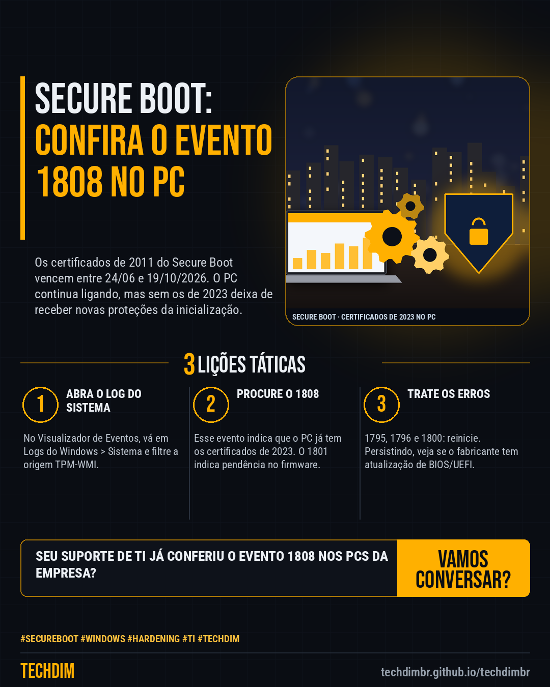

# Conhecimento — Secure Boot: confira em 5 passos se seus PCs já têm os certificados de 2023 da Microsoft

- **Data:** 2026-10-24, 14:23 (horário de Brasília)
- **Curadoria:** Claude (Routine) — pauta do dia
- **Execução no Actions:** https://github.com/Techdimbr/Publi-midia-Techdim/actions/runs/40115869395
- **Por que esta pauta:** Dica prática e atual: os certificados de 2011 do Secure Boot vencem entre junho e 19/10/2026, e a página de eventos da Microsoft permite conferir, no próprio Windows, quais PCs já receberam os de 2023.

## Resultado

| Rede | Status | Link | 1º comentário |
|---|---|---|---|
| linkedin | ✅ publicado | https://www.linkedin.com/feed/update/urn:li:share:7519810832021471233/ | — |
| facebook | ✅ publicado | https://www.facebook.com/122132402349390486/posts/122138225277390486 | ✅ |
| instagram | ✅ publicado | https://www.instagram.com/p/De4qUQtF_3F/ | ✅ |

## Fontes

- [support.microsoft.com (eventos do Secure Boot)](https://support.microsoft.com/en-us/topic/secure-boot-db-and-dbx-variable-update-events-37e47cf8-608b-4a87-8175-bdead630eb69)
- [support.microsoft.com (certificados do Secure Boot)](https://support.microsoft.com/en-us/topic/windows-secure-boot-certificate-expiration-and-ca-updates-7ff40d33-95dc-4c3c-8725-a9b95457578e)

## Linkedin

```text
Secure Boot: confira em 5 passos se seus PCs já têm os certificados de 2023 da Microsoft

01. Os certificados de 2011 do Secure Boot vencem entre 24/06 e 19/10/2026. 1) No Visualizador de Eventos, abra Logs do Windows > Sistema e filtre a origem TPM-WMI
02. 2) Evento 1808: o PC já tem os certificados de 2023. 3) Evento 1801: atualização feita, ainda pendente no firmware. 4) Erros 1795, 1796 ou 1800: reinicie e confira
03. 5) Sem o 1808, instale as atualizações do Windows e veja se o fabricante tem BIOS/UEFI nova. Sem os certificados de 2023, o PC liga, mas perde proteções de boot

Quantos PCs da sua empresa já mostram o evento 1808? Comece por um e peça ao seu suporte de TI para repetir nos demais.

Fontes: https://support.microsoft.com/en-us/topic/secure-boot-db-and-dbx-variable-update-events-37e47cf8-608b-4a87-8175-bdead630eb69 · https://support.microsoft.com/en-us/topic/windows-secure-boot-certificate-expiration-and-ca-updates-7ff40d33-95dc-4c3c-8725-a9b95457578e

TECHDIM — Infraestrutura · Segurança · IA
https://techdimbr.github.io/techdimbr/

#SecureBoot #Windows #Hardening #TI #TECHDIM
```



## Facebook

```text
Secure Boot: confira em 5 passos se seus PCs já têm os certificados de 2023 da Microsoft

• Os certificados de 2011 do Secure Boot vencem entre 24/06 e 19/10/2026. 1) No Visualizador de Eventos, abra Logs do Windows > Sistema e filtre a origem TPM-WMI
• 2) Evento 1808: o PC já tem os certificados de 2023. 3) Evento 1801: atualização feita, ainda pendente no firmware. 4) Erros 1795, 1796 ou 1800: reinicie e confira
• 5) Sem o 1808, instale as atualizações do Windows e veja se o fabricante tem BIOS/UEFI nova. Sem os certificados de 2023, o PC liga, mas perde proteções de boot

Quantos PCs da sua empresa já mostram o evento 1808? Comece por um e peça ao seu suporte de TI para repetir nos demais.

Fale com a TECHDIM — fontes e site no primeiro comentário 👇

#SecureBoot #Windows #Hardening #TECHDIM
```

Primeiro comentário:

```text
📎 Fontes:
• support.microsoft.com (eventos do Secure Boot): https://support.microsoft.com/en-us/topic/secure-boot-db-and-dbx-variable-update-events-37e47cf8-608b-4a87-8175-bdead630eb69
• support.microsoft.com (certificados do Secure Boot): https://support.microsoft.com/en-us/topic/windows-secure-boot-certificate-expiration-and-ca-updates-7ff40d33-95dc-4c3c-8725-a9b95457578e

🌐 TECHDIM — Infraestrutura · Segurança · IA: https://techdimbr.github.io/techdimbr/
```


## Instagram

```text
Secure Boot: confira em 5 passos se seus PCs já têm os certificados de 2023 da Microsoft

1️⃣ Os certificados de 2011 do Secure Boot vencem entre 24/06 e 19/10/2026. 1) No Visualizador de Eventos, abra Logs do Windows > Sistema e filtre a origem TPM-WMI
2️⃣ 2) Evento 1808: o PC já tem os certificados de 2023. 3) Evento 1801: atualização feita, ainda pendente no firmware. 4) Erros 1795, 1796 ou 1800: reinicie e confira
3️⃣ 5) Sem o 1808, instale as atualizações do Windows e veja se o fabricante tem BIOS/UEFI nova. Sem os certificados de 2023, o PC liga, mas perde proteções de boot

Quantos PCs da sua empresa já mostram o evento 1808? Comece por um e peça ao seu suporte de TI para repetir nos demais.

🔗 Link na bio: techdimbr.github.io/techdimbr
Fontes no primeiro comentário 👇

#secureboot #windows #hardening #ti #techdim #conhecimento #aprendati #tecnologia
```

Primeiro comentário:

```text
📎 Fontes: support.microsoft.com (eventos do Secure Boot) · support.microsoft.com (certificados do Secure Boot)
```


