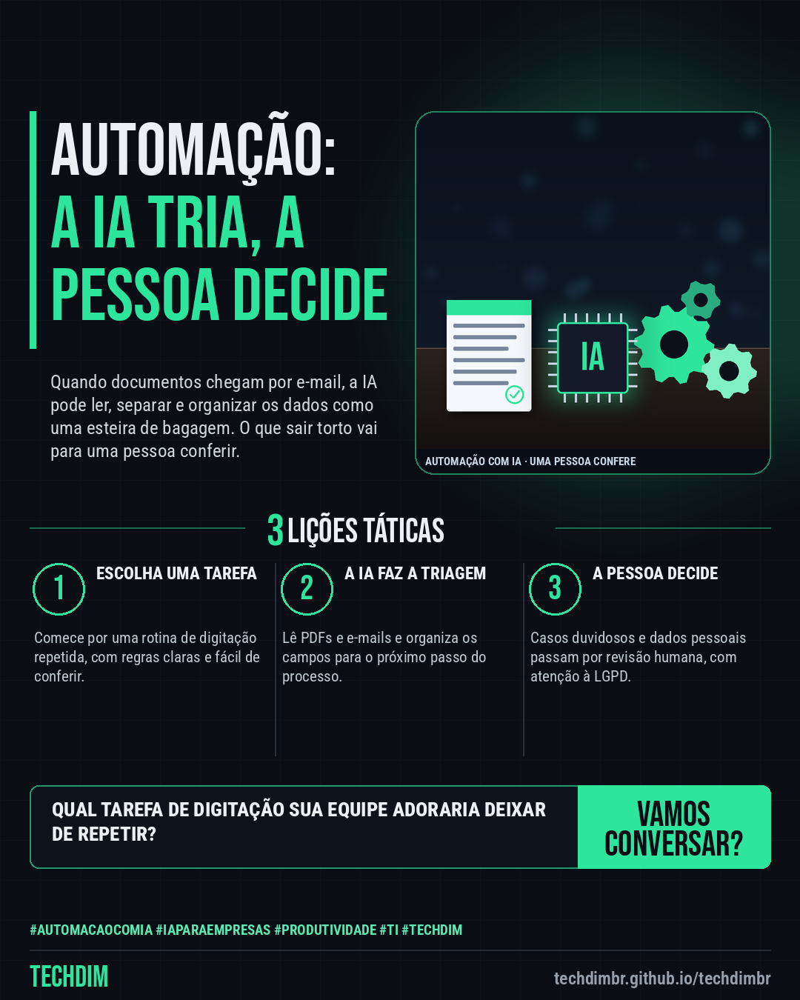

# TECHDIM · Serviços — Automação com IA: do PDF que chega por e-mail à planilha, com uma pessoa conferindo

- **Data:** 2026-10-24, 17:24 (horário de Brasília)
- **Curadoria:** Claude (Routine) — pauta do dia
- **Execução no Actions:** https://github.com/Techdimbr/Publi-midia-Techdim/actions/runs/40129576231
- **Por que esta pauta:** Apresenta o serviço de automação com IA com um caso concreto (documentos por e-mail virando dados na planilha) e a ideia de triagem com revisão humana, sem promessa de preço, prazo ou resultado.

## Resultado

| Rede | Status | Link | 1º comentário |
|---|---|---|---|
| linkedin | ✅ publicado | https://www.linkedin.com/feed/update/urn:li:share:7519856311644164096/ | — |
| facebook | ✅ publicado | https://www.facebook.com/122132402349390486/posts/122138249385390486 | ✅ |
| instagram | ✅ publicado | https://www.instagram.com/p/De4_A7ZAb9Y/ | — |

## Linkedin

```text
Automação com IA: do PDF que chega por e-mail à planilha, com uma pessoa conferindo

01. Nota fiscal, boleto ou pedido chega por e-mail e alguém digita tudo na planilha? Uma automação com IA pode ler o PDF, separar os campos e deixar tudo pronto para conferir
02. A TECHDIM monta automações com IA sob medida: a IA faz a triagem como uma esteira de bagagem, e o que sair torto vai para uma pessoa decidir antes de valer
03. Conte qual tarefa de digitação trava sua equipe. A TECHDIM avalia o processo e os cuidados com dados pessoais (LGPD) e propõe os próximos passos, sem compromisso

Qual tarefa de digitação mais cansa sua equipe? Conte para a TECHDIM: techdimbr.github.io/techdimbr

TECHDIM — Infraestrutura · Segurança · IA
https://techdimbr.github.io/techdimbr/

#AutomacaoComIA #IAParaEmpresas #Produtividade #TI #TECHDIM
```



## Facebook

```text
Automação com IA: do PDF que chega por e-mail à planilha, com uma pessoa conferindo

• Nota fiscal, boleto ou pedido chega por e-mail e alguém digita tudo na planilha? Uma automação com IA pode ler o PDF, separar os campos e deixar tudo pronto para conferir
• A TECHDIM monta automações com IA sob medida: a IA faz a triagem como uma esteira de bagagem, e o que sair torto vai para uma pessoa decidir antes de valer
• Conte qual tarefa de digitação trava sua equipe. A TECHDIM avalia o processo e os cuidados com dados pessoais (LGPD) e propõe os próximos passos, sem compromisso

Qual tarefa de digitação mais cansa sua equipe? Conte para a TECHDIM: techdimbr.github.io/techdimbr

Fale com a TECHDIM — link no primeiro comentário 👇

#AutomacaoComIA #IAParaEmpresas #Produtividade #TECHDIM
```

Primeiro comentário:

```text
🌐 TECHDIM — Infraestrutura · Segurança · IA: https://techdimbr.github.io/techdimbr/
```


## Instagram

```text
Automação com IA: do PDF que chega por e-mail à planilha, com uma pessoa conferindo

1️⃣ Nota fiscal, boleto ou pedido chega por e-mail e alguém digita tudo na planilha? Uma automação com IA pode ler o PDF, separar os campos e deixar tudo pronto para conferir
2️⃣ A TECHDIM monta automações com IA sob medida: a IA faz a triagem como uma esteira de bagagem, e o que sair torto vai para uma pessoa decidir antes de valer
3️⃣ Conte qual tarefa de digitação trava sua equipe. A TECHDIM avalia o processo e os cuidados com dados pessoais (LGPD) e propõe os próximos passos, sem compromisso

Qual tarefa de digitação mais cansa sua equipe? Conte para a TECHDIM: techdimbr.github.io/techdimbr

🔗 Link na bio: techdimbr.github.io/techdimbr

#automacaocomia #iaparaempresas #produtividade #ti #techdim #suportetecnico #ciberseguranca #automacao
```


