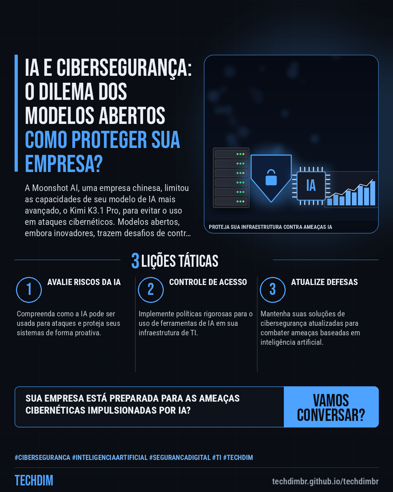
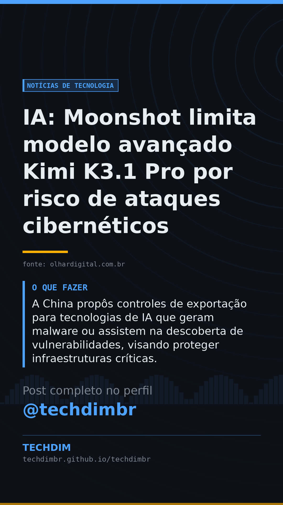

# Notícias de Tecnologia — IA: Moonshot limita modelo avançado Kimi K3.1 Pro por risco de ataques cibernéticos

- **Data:** 2026-10-25, 11:57 (horário de Brasília)
- **Curadoria:** Gemini (reserva) — pauta escrita pela API do Gemini (modelo gemini-2.5-flash)
- **Execução no Actions:** https://github.com/Techdimbr/Publi-midia-Techdim/actions/runs/40204550232
- **Por que esta pauta:** A crescente sofisticação dos ataques cibernéticos impulsionados por IA exige atenção constante à segurança.

## Resultado

| Rede | Status | Link | 1º comentário |
|---|---|---|---|
| linkedin | ✅ publicado | https://www.linkedin.com/feed/update/urn:li:share:7520136305498910722/ | — |
| facebook | ✅ publicado | https://www.facebook.com/122132402349390486/posts/122138467449390486 | ✅ |
| instagram | ✅ publicado | https://www.instagram.com/p/De6-U7boPel/ | ✅ |
| Stories | ✅ publicado | https://www.instagram.com/stories/techdimbr/4015796253322393591 | — |

## Fontes

- [olhardigital.com.br](https://olhardigital.com.br/2026/10/25/inteligencia-artificial/moonshot-limita-capacidades-de-seu-modelo-de-ia-mais-avancado-para-evitar-ataques-hackers/)

## Linkedin

```text
IA: Moonshot limita modelo avançado Kimi K3.1 Pro por risco de ataques cibernéticos

01. A startup chinesa Moonshot AI reduziu as capacidades ciberofensivas de seu modelo avançado Kimi K3.1 Pro devido a preocupações com ataques hackers mais sofisticados.
02. A ferramenta, um modelo aberto, permite a desenvolvedores externos executá-la e modificá-la, apresentando desafios no controle e monitoramento de uso.
03. A China propôs controles de exportação para tecnologias de IA que geram malware ou assistem na descoberta de vulnerabilidades, visando proteger infraestruturas críticas.

A TECHDIM oferece soluções de cibersegurança defensiva e automação com IA, protegendo sua infraestrutura e dados contra ameaças digitais.

Fontes: https://olhardigital.com.br/2026/10/25/inteligencia-artificial/moonshot-limita-capacidades-de-seu-modelo-de-ia-mais-avancado-para-evitar-ataques-hackers/

TECHDIM — Infraestrutura · Segurança · IA
https://techdimbr.github.io/techdimbr/

#Ciberseguranca #InteligenciaArtificial #SegurancaDigital #TI #TECHDIM
```



## Facebook

```text
IA: Moonshot limita modelo avançado Kimi K3.1 Pro por risco de ataques cibernéticos

• A startup chinesa Moonshot AI reduziu as capacidades ciberofensivas de seu modelo avançado Kimi K3.1 Pro devido a preocupações com ataques hackers mais sofisticados.
• A ferramenta, um modelo aberto, permite a desenvolvedores externos executá-la e modificá-la, apresentando desafios no controle e monitoramento de uso.
• A China propôs controles de exportação para tecnologias de IA que geram malware ou assistem na descoberta de vulnerabilidades, visando proteger infraestruturas críticas.

A TECHDIM oferece soluções de cibersegurança defensiva e automação com IA, protegendo sua infraestrutura e dados contra ameaças digitais.

Fale com a TECHDIM — fontes e site no primeiro comentário 👇

#Ciberseguranca #InteligenciaArtificial #SegurancaDigital #TECHDIM
```

Primeiro comentário:

```text
📎 Fontes:
• olhardigital.com.br: https://olhardigital.com.br/2026/10/25/inteligencia-artificial/moonshot-limita-capacidades-de-seu-modelo-de-ia-mais-avancado-para-evitar-ataques-hackers/

🌐 TECHDIM — Infraestrutura · Segurança · IA: https://techdimbr.github.io/techdimbr/
```


## Instagram

```text
IA: Moonshot limita modelo avançado Kimi K3.1 Pro por risco de ataques cibernéticos

1️⃣ A startup chinesa Moonshot AI reduziu as capacidades ciberofensivas de seu modelo avançado Kimi K3.1 Pro devido a preocupações com ataques hackers mais sofisticados.
2️⃣ A ferramenta, um modelo aberto, permite a desenvolvedores externos executá-la e modificá-la, apresentando desafios no controle e monitoramento de uso.
3️⃣ A China propôs controles de exportação para tecnologias de IA que geram malware ou assistem na descoberta de vulnerabilidades, visando proteger infraestruturas críticas.

A TECHDIM oferece soluções de cibersegurança defensiva e automação com IA, protegendo sua infraestrutura e dados contra ameaças digitais.

🔗 Link na bio: techdimbr.github.io/techdimbr
Fontes no primeiro comentário 👇

#ciberseguranca #inteligenciaartificial #segurancadigital #ti #techdim #tecnologia #ia #inovacao
```

Primeiro comentário:

```text
📎 Fontes: olhardigital.com.br
```


## Stories


