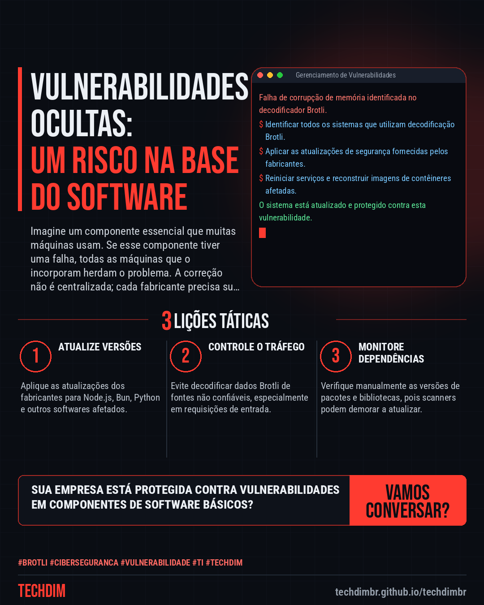

# Cibersegurança · IA · Hacker — Vulnerabilidade Brotli: Falha de Corrupção de Memória Afeta Node.js, Bun e Python

- **Data:** 2026-10-25, 14:37 (horário de Brasília)
- **Curadoria:** Gemini (reserva) — pauta escrita pela API do Gemini (modelo gemini-2.5-flash)
- **Execução no Actions:** https://github.com/Techdimbr/Publi-midia-Techdim/actions/runs/40217214269
- **Por que esta pauta:** Esta falha generalizada exige atenção imediata devido ao seu impacto potencial em diversas plataformas amplamente utilizadas.

## Resultado

| Rede | Status | Link | 1º comentário |
|---|---|---|---|
| linkedin | ✅ publicado | https://www.linkedin.com/feed/update/urn:li:share:7520176430928986112/ | — |
| facebook | ✅ publicado | https://www.facebook.com/122132402349390486/posts/122138493207390486 | ✅ |
| instagram | ✅ publicado | https://www.instagram.com/p/De7QkyXCfn7/ | ✅ |
| Stories | ✅ publicado | https://www.instagram.com/stories/techdimbr/4015876591917299751 | — |

## Fontes

- [thehackernews.com](https://thehackernews.com/2026/10/brotli-decoder-flaw-behind-nodejs-rce.html)

## Linkedin

```text
Vulnerabilidade Brotli: Falha de Corrupção de Memória Afeta Node.js, Bun e Python

01. Uma falha de corrupção de memória no decodificador Brotli do Google afeta diversos programas, como Node.js, Bun, pacotes Python e proxies Envoy.
02. A vulnerabilidade (CVE-2026-111497) pode causar travamentos, vazamento de memória ou, em alguns casos, execução remota de código por invasores.
03. A exposição ocorre ao decodificar dados Brotli não confiáveis; a correção exige que cada programa atualize sua cópia do decodificador.

Manter sistemas atualizados e monitorar vulnerabilidades é essencial para proteger sua infraestrutura de TI contra ameaças.

Fontes: https://thehackernews.com/2026/10/brotli-decoder-flaw-behind-nodejs-rce.html

TECHDIM — Infraestrutura · Segurança · IA
https://techdimbr.github.io/techdimbr/

#Brotli #Ciberseguranca #Vulnerabilidade #TI #TECHDIM
```



## Facebook

```text
Vulnerabilidade Brotli: Falha de Corrupção de Memória Afeta Node.js, Bun e Python

• Uma falha de corrupção de memória no decodificador Brotli do Google afeta diversos programas, como Node.js, Bun, pacotes Python e proxies Envoy.
• A vulnerabilidade (CVE-2026-111497) pode causar travamentos, vazamento de memória ou, em alguns casos, execução remota de código por invasores.
• A exposição ocorre ao decodificar dados Brotli não confiáveis; a correção exige que cada programa atualize sua cópia do decodificador.

Manter sistemas atualizados e monitorar vulnerabilidades é essencial para proteger sua infraestrutura de TI contra ameaças.

Fale com a TECHDIM — fontes e site no primeiro comentário 👇

#Brotli #Ciberseguranca #Vulnerabilidade #TECHDIM
```

Primeiro comentário:

```text
📎 Fontes:
• thehackernews.com: https://thehackernews.com/2026/10/brotli-decoder-flaw-behind-nodejs-rce.html

🌐 TECHDIM — Infraestrutura · Segurança · IA: https://techdimbr.github.io/techdimbr/
```


## Instagram

```text
Vulnerabilidade Brotli: Falha de Corrupção de Memória Afeta Node.js, Bun e Python

1️⃣ Uma falha de corrupção de memória no decodificador Brotli do Google afeta diversos programas, como Node.js, Bun, pacotes Python e proxies Envoy.
2️⃣ A vulnerabilidade (CVE-2026-111497) pode causar travamentos, vazamento de memória ou, em alguns casos, execução remota de código por invasores.
3️⃣ A exposição ocorre ao decodificar dados Brotli não confiáveis; a correção exige que cada programa atualize sua cópia do decodificador.

Manter sistemas atualizados e monitorar vulnerabilidades é essencial para proteger sua infraestrutura de TI contra ameaças.

🔗 Link na bio: techdimbr.github.io/techdimbr
Fontes no primeiro comentário 👇

#brotli #ciberseguranca #vulnerabilidade #ti #techdim #seguranca #hacker #infraestrutura
```

Primeiro comentário:

```text
📎 Fontes: thehackernews.com
```


## Stories


