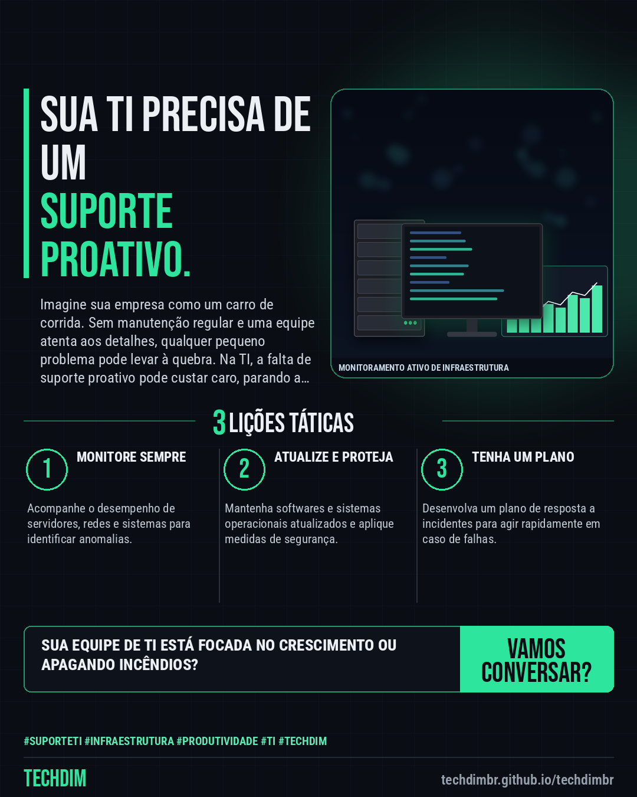

# TECHDIM · Serviços — Suporte de TI: garanta a produtividade e a segurança da sua infraestrutura

- **Data:** 2026-10-25, 19:41 (horário de Brasília)
- **Curadoria:** Gemini (reserva) — pauta escrita pela API do Gemini (modelo gemini-2.5-flash)
- **Execução no Actions:** https://github.com/Techdimbr/Publi-midia-Techdim/actions/runs/40241288496
- **Por que esta pauta:** Manter a TI funcionando sem interrupções é fundamental para a continuidade dos negócios, e um suporte eficaz é a chave.

## Resultado

| Rede | Status | Link | 1º comentário |
|---|---|---|---|
| linkedin | ✅ publicado | https://www.linkedin.com/feed/update/urn:li:share:7520253081310318592/ | — |
| facebook | ✅ publicado | https://www.facebook.com/122132402349390486/posts/122138529195390486 | ✅ |
| instagram | ✅ publicado | https://www.instagram.com/p/De7zctUDaPZ/ | — |

## Linkedin

```text
Suporte de TI: garanta a produtividade e a segurança da sua infraestrutura

01. A infraestrutura de TI é o alicerce da operação de qualquer empresa, exigindo atenção constante para evitar interrupções.
02. Falhas em sistemas, redes ou equipamentos podem gerar perdas financeiras e de produtividade, afetando a reputação do negócio.
03. Um suporte de TI proativo identifica e resolve problemas antes que eles impactem o ambiente, mantendo a operação fluida e segura.

A TECHDIM oferece suporte de TI especializado para que sua empresa mantenha o foco no negócio, com infraestrutura e redes otimizadas.

TECHDIM — Infraestrutura · Segurança · IA
https://techdimbr.github.io/techdimbr/

#SuporteTI #Infraestrutura #Produtividade #TI #TECHDIM
```



## Facebook

```text
Suporte de TI: garanta a produtividade e a segurança da sua infraestrutura

• A infraestrutura de TI é o alicerce da operação de qualquer empresa, exigindo atenção constante para evitar interrupções.
• Falhas em sistemas, redes ou equipamentos podem gerar perdas financeiras e de produtividade, afetando a reputação do negócio.
• Um suporte de TI proativo identifica e resolve problemas antes que eles impactem o ambiente, mantendo a operação fluida e segura.

A TECHDIM oferece suporte de TI especializado para que sua empresa mantenha o foco no negócio, com infraestrutura e redes otimizadas.

Fale com a TECHDIM — link no primeiro comentário 👇

#SuporteTI #Infraestrutura #Produtividade #TECHDIM
```

Primeiro comentário:

```text
🌐 TECHDIM — Infraestrutura · Segurança · IA: https://techdimbr.github.io/techdimbr/
```


## Instagram

```text
Suporte de TI: garanta a produtividade e a segurança da sua infraestrutura

1️⃣ A infraestrutura de TI é o alicerce da operação de qualquer empresa, exigindo atenção constante para evitar interrupções.
2️⃣ Falhas em sistemas, redes ou equipamentos podem gerar perdas financeiras e de produtividade, afetando a reputação do negócio.
3️⃣ Um suporte de TI proativo identifica e resolve problemas antes que eles impactem o ambiente, mantendo a operação fluida e segura.

A TECHDIM oferece suporte de TI especializado para que sua empresa mantenha o foco no negócio, com infraestrutura e redes otimizadas.

🔗 Link na bio: techdimbr.github.io/techdimbr

#suporteti #infraestrutura #produtividade #ti #techdim #suportetecnico #ciberseguranca #automacao
```


