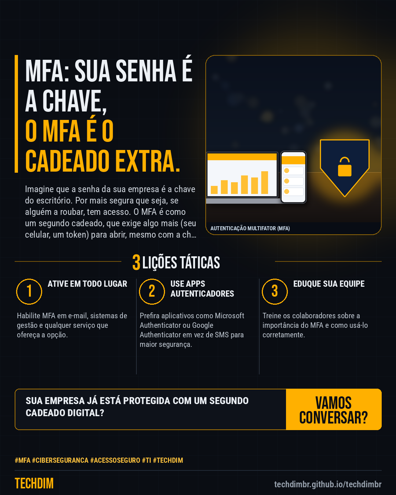

# Conhecimento — MFA: Por que a senha forte já não basta para proteger seus acessos na empresa

- **Data:** 2026-10-26, 04:25 (horário de Brasília)
- **Curadoria:** Gemini (reserva) — pauta escrita pela API do Gemini (modelo gemini-2.5-flash)
- **Execução no Actions:** https://github.com/Techdimbr/Publi-midia-Techdim/actions/runs/40285586298
- **Por que esta pauta:** A segurança da informação é um processo contínuo que exige adaptação às novas ameaças.

## Resultado

| Rede | Status | Link | 1º comentário |
|---|---|---|---|
| linkedin | ✅ publicado | https://www.linkedin.com/feed/update/urn:li:share:7520384946537005056/ | — |
| facebook | ✅ publicado | https://www.facebook.com/122132402349390486/posts/122138599083390486 | ✅ |
| instagram | ✅ publicado | https://www.instagram.com/p/De8vZMvDT8M/ | — |

## Linkedin

```text
MFA: Por que a senha forte já não basta para proteger seus acessos na empresa

01. A autenticação multifator (MFA) adiciona uma camada de segurança, exigindo uma segunda forma de verificação além da senha.
02. Mesmo senhas complexas podem ser comprometidas por phishing, vazamentos de dados ou ataques de força bruta.
03. Com MFA, um invasor que roube sua senha ainda precisaria de acesso ao seu segundo fator (celular, token) para entrar.

A TECHDIM implementa e gerencia soluções de MFA, fortalecendo a segurança dos acessos da sua empresa contra ameaças.

TECHDIM — Infraestrutura · Segurança · IA
https://techdimbr.github.io/techdimbr/

#MFA #Ciberseguranca #AcessoSeguro #TI #TECHDIM
```



## Facebook

```text
MFA: Por que a senha forte já não basta para proteger seus acessos na empresa

• A autenticação multifator (MFA) adiciona uma camada de segurança, exigindo uma segunda forma de verificação além da senha.
• Mesmo senhas complexas podem ser comprometidas por phishing, vazamentos de dados ou ataques de força bruta.
• Com MFA, um invasor que roube sua senha ainda precisaria de acesso ao seu segundo fator (celular, token) para entrar.

A TECHDIM implementa e gerencia soluções de MFA, fortalecendo a segurança dos acessos da sua empresa contra ameaças.

Fale com a TECHDIM — link no primeiro comentário 👇

#MFA #Ciberseguranca #AcessoSeguro #TECHDIM
```

Primeiro comentário:

```text
🌐 TECHDIM — Infraestrutura · Segurança · IA: https://techdimbr.github.io/techdimbr/
```


## Instagram

```text
MFA: Por que a senha forte já não basta para proteger seus acessos na empresa

1️⃣ A autenticação multifator (MFA) adiciona uma camada de segurança, exigindo uma segunda forma de verificação além da senha.
2️⃣ Mesmo senhas complexas podem ser comprometidas por phishing, vazamentos de dados ou ataques de força bruta.
3️⃣ Com MFA, um invasor que roube sua senha ainda precisaria de acesso ao seu segundo fator (celular, token) para entrar.

A TECHDIM implementa e gerencia soluções de MFA, fortalecendo a segurança dos acessos da sua empresa contra ameaças.

🔗 Link na bio: techdimbr.github.io/techdimbr

#mfa #ciberseguranca #acessoseguro #ti #techdim #conhecimento #aprendati #tecnologia
```


