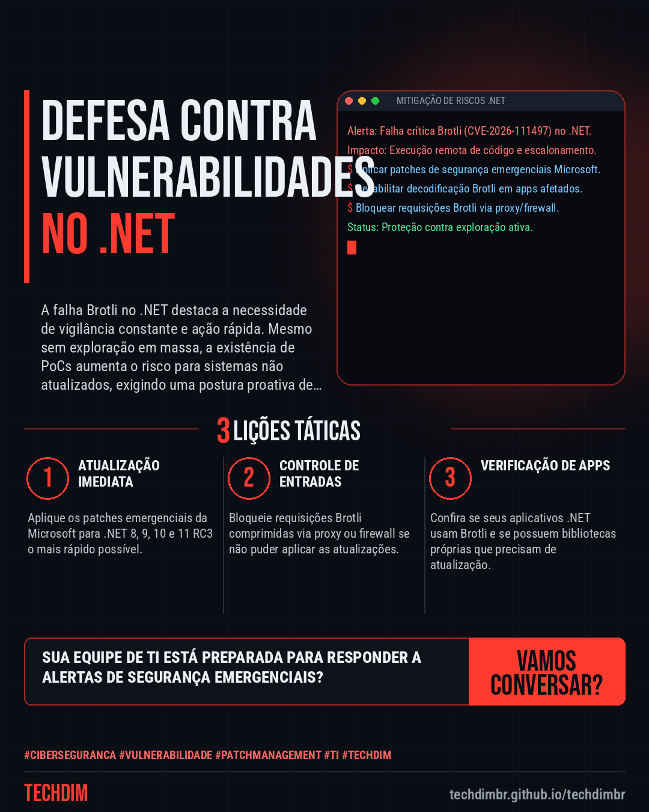
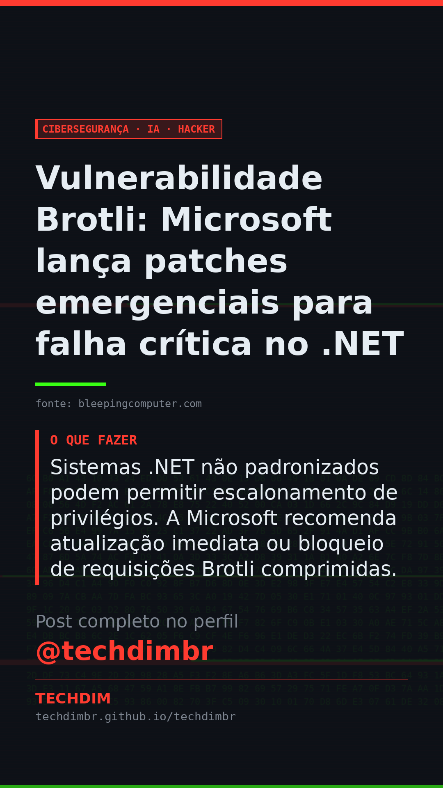

# Cibersegurança · IA · Hacker — Vulnerabilidade Brotli: Microsoft lança patches emergenciais para falha crítica no .NET

- **Data:** 2026-10-26, 16:52 (horário de Brasília)
- **Curadoria:** Claude (Routine) — pauta do dia
- **Execução no Actions:** https://github.com/Techdimbr/Publi-midia-Techdim/actions/runs/40390419424
- **Por que esta pauta:** Este alerta da Microsoft é crucial para proteger sistemas .NET e prevenir ataques de execução remota de código.

## Resultado

| Rede | Status | Link | 1º comentário |
|---|---|---|---|
| linkedin | ✅ publicado | https://www.linkedin.com/feed/update/urn:li:share:7520572893559164928/ | — |
| facebook | ✅ publicado | https://www.facebook.com/122132402349390486/posts/122138727045390486 | ✅ |
| instagram | ✅ publicado | https://www.instagram.com/p/De-E2ynl16W/ | ✅ |
| Stories | ✅ publicado | https://www.instagram.com/stories/techdimbr/4016669396223607347 | — |

## Fontes

- [bleepingcomputer.com](https://www.bleepingcomputer.com/news/microsoft/microsoft-releases-emergency-net-patches-for-critical-brotli-flaw/)

## Linkedin

```text
Vulnerabilidade Brotli: Microsoft lança patches emergenciais para falha crítica no .NET

01. Microsoft lançou atualizações emergenciais para corrigir a falha crítica Brotli (CVE-2026-111497) no .NET, conhecida como Broccoli2Shell.
02. A falha, descoberta pela Imperva Red Team, é uma escrita fora dos limites no decodificador Brotli que pode causar travamentos, vazamento de memória ou execução remota de código.
03. Sistemas .NET não padronizados podem permitir escalonamento de privilégios. A Microsoft recomenda atualização imediata ou bloqueio de requisições Brotli comprimidas.

A TECHDIM implementa hardening e gestão de patches para proteger sua infraestrutura de TI contra vulnerabilidades como esta.

Fontes: https://www.bleepingcomputer.com/news/microsoft/microsoft-releases-emergency-net-patches-for-critical-brotli-flaw/

TECHDIM — Infraestrutura · Segurança · IA
https://techdimbr.github.io/techdimbr/

#Ciberseguranca #Vulnerabilidade #PatchManagement #TI #TECHDIM
```



## Facebook

```text
Vulnerabilidade Brotli: Microsoft lança patches emergenciais para falha crítica no .NET

• Microsoft lançou atualizações emergenciais para corrigir a falha crítica Brotli (CVE-2026-111497) no .NET, conhecida como Broccoli2Shell.
• A falha, descoberta pela Imperva Red Team, é uma escrita fora dos limites no decodificador Brotli que pode causar travamentos, vazamento de memória ou execução remota de código.
• Sistemas .NET não padronizados podem permitir escalonamento de privilégios. A Microsoft recomenda atualização imediata ou bloqueio de requisições Brotli comprimidas.

A TECHDIM implementa hardening e gestão de patches para proteger sua infraestrutura de TI contra vulnerabilidades como esta.

Fale com a TECHDIM — fontes e site no primeiro comentário 👇

#Ciberseguranca #Vulnerabilidade #PatchManagement #TECHDIM
```

Primeiro comentário:

```text
📎 Fontes:
• bleepingcomputer.com: https://www.bleepingcomputer.com/news/microsoft/microsoft-releases-emergency-net-patches-for-critical-brotli-flaw/

🌐 TECHDIM — Infraestrutura · Segurança · IA: https://techdimbr.github.io/techdimbr/
```


## Instagram

```text
Vulnerabilidade Brotli: Microsoft lança patches emergenciais para falha crítica no .NET

1️⃣ Microsoft lançou atualizações emergenciais para corrigir a falha crítica Brotli (CVE-2026-111497) no .NET, conhecida como Broccoli2Shell.
2️⃣ A falha, descoberta pela Imperva Red Team, é uma escrita fora dos limites no decodificador Brotli que pode causar travamentos, vazamento de memória ou execução remota de código.
3️⃣ Sistemas .NET não padronizados podem permitir escalonamento de privilégios. A Microsoft recomenda atualização imediata ou bloqueio de requisições Brotli comprimidas.

A TECHDIM implementa hardening e gestão de patches para proteger sua infraestrutura de TI contra vulnerabilidades como esta.

🔗 Link na bio: techdimbr.github.io/techdimbr
Fontes no primeiro comentário 👇

#ciberseguranca #vulnerabilidade #patchmanagement #ti #techdim #seguranca #hacker #infraestrutura
```

Primeiro comentário:

```text
📎 Fontes: bleepingcomputer.com
```


## Stories


