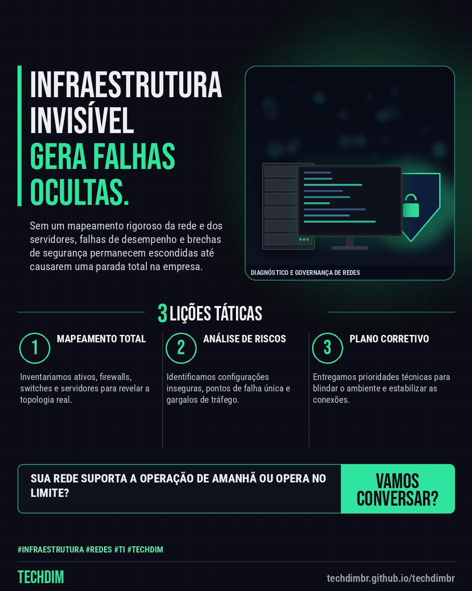

# TECHDIM · Serviços — Diagnóstico de infraestrutura: identifique gargalos na sua rede com a TECHDIM

- **Data:** 2026-10-26, 20:57 (horário de Brasília)
- **Curadoria:** Claude (Routine) — pauta do dia
- **Execução no Actions:** https://github.com/Techdimbr/Publi-midia-Techdim/actions/runs/40423171405
- **Por que esta pauta:** Empresas crescem e modificam suas redes sem documentação, acumulando riscos invisíveis que causam paralisações e brechas de segurança.

## Resultado

| Rede | Status | Link | 1º comentário |
|---|---|---|---|
| linkedin | ✅ publicado | https://www.linkedin.com/feed/update/urn:li:share:7520634734725615616/ | — |
| facebook | ✅ publicado | https://www.facebook.com/122132402349390486/posts/122138757123390486 | ✅ |
| instagram | ✅ publicado | https://www.instagram.com/p/De-g_PDD6-0/ | — |

## Linkedin

```text
Diagnóstico de infraestrutura: identifique gargalos na sua rede com a TECHDIM

01. A TECHDIM realiza um diagnóstico completo de infraestrutura e segurança para mapear vulnerabilidades em redes, servidores e estações.
02. A análise detalhada identifica pontos únicos de falha, riscos de segurança e gargalos de desempenho que afetam a operação diária.
03. Nossa equipe de engenharia entrega um relatório técnico acionável para orientar correções estruturais e melhorias de hardening.

Conheça o diagnóstico de infraestrutura da TECHDIM para blindar suas operações em techdimbr.github.io/techdimbr.

TECHDIM — Infraestrutura · Segurança · IA
https://techdimbr.github.io/techdimbr/

#Infraestrutura #Redes #TI #TECHDIM #InfraestruturaDeTI
```



## Facebook

```text
Diagnóstico de infraestrutura: identifique gargalos na sua rede com a TECHDIM

• A TECHDIM realiza um diagnóstico completo de infraestrutura e segurança para mapear vulnerabilidades em redes, servidores e estações.
• A análise detalhada identifica pontos únicos de falha, riscos de segurança e gargalos de desempenho que afetam a operação diária.
• Nossa equipe de engenharia entrega um relatório técnico acionável para orientar correções estruturais e melhorias de hardening.

Conheça o diagnóstico de infraestrutura da TECHDIM para blindar suas operações em techdimbr.github.io/techdimbr.

Fale com a TECHDIM — link no primeiro comentário 👇

#Infraestrutura #Redes #TI #TECHDIM
```

Primeiro comentário:

```text
🌐 TECHDIM — Infraestrutura · Segurança · IA: https://techdimbr.github.io/techdimbr/
```


## Instagram

```text
Diagnóstico de infraestrutura: identifique gargalos na sua rede com a TECHDIM

1️⃣ A TECHDIM realiza um diagnóstico completo de infraestrutura e segurança para mapear vulnerabilidades em redes, servidores e estações.
2️⃣ A análise detalhada identifica pontos únicos de falha, riscos de segurança e gargalos de desempenho que afetam a operação diária.
3️⃣ Nossa equipe de engenharia entrega um relatório técnico acionável para orientar correções estruturais e melhorias de hardening.

Conheça o diagnóstico de infraestrutura da TECHDIM para blindar suas operações em techdimbr.github.io/techdimbr.

🔗 Link na bio: techdimbr.github.io/techdimbr

#infraestrutura #redes #ti #techdim #suportetecnico #ciberseguranca #automacao #campinas
```


