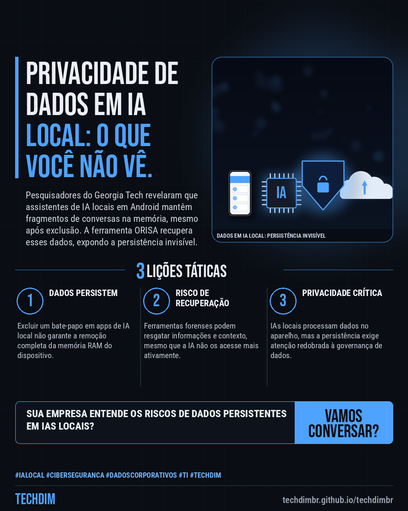

# Notícias de Tecnologia — IA local: Excluir histórico não apaga rastros em celulares Android

- **Data:** 2026-10-27, 13:33 (horário de Brasília)
- **Curadoria:** Claude (Routine) — pauta do dia
- **Execução no Actions:** https://github.com/Techdimbr/Publi-midia-Techdim/actions/runs/40541889286
- **Por que esta pauta:** A pesquisa destaca a importância de entender a persistência de dados em IAs locais para a segurança corporativa e a privacidade das informações.

## Resultado

| Rede | Status | Link | 1º comentário |
|---|---|---|---|
| linkedin | ✅ publicado | https://www.linkedin.com/feed/update/urn:li:share:7520885304191545346/ | — |
| facebook | ✅ publicado | https://www.facebook.com/122132402349390486/posts/122138896683390486 | ✅ |
| instagram | ✅ publicado | https://www.instagram.com/p/DfAS7TciYct/ | ✅ |
| Stories | ✅ publicado | https://www.instagram.com/stories/techdimbr/4017294216379610572 | — |

## Fontes

- [canaltech.com.br](https://canaltech.com.br/inteligencia-artificial/cuidado-excluir-historico-de-ia-nao-apaga-rastros-em-celulares-android/)

## Linkedin

```text
IA local: Excluir histórico não apaga rastros em celulares Android

01. Pesquisadores do Georgia Tech desenvolveram a ferramenta ORISA, capaz de recuperar conversas excluídas de assistentes de IA que operam localmente em celulares Android.
02. A exclusão de um bate-papo via interface do aplicativo não remove imediatamente todos os dados da memória RAM, permitindo à ORISA reconstruir o contexto e sessões funcionais.
03. A descoberta, útil para perícia digital, levanta questões cruciais sobre a privacidade de dados em assistentes de IA com processamento local, como Google AI Edge Gallery e ChatterUI.

A proteção e governança de dados, mesmo em IAs locais, são essenciais. A TECHDIM oferece cibersegurança defensiva e gestão de dados.

Fontes: https://canaltech.com.br/inteligencia-artificial/cuidado-excluir-historico-de-ia-nao-apaga-rastros-em-celulares-android/

TECHDIM — Infraestrutura · Segurança · IA
https://techdimbr.github.io/techdimbr/

#IAlocal #Ciberseguranca #DadosCorporativos #TI #TECHDIM
```



## Facebook

```text
IA local: Excluir histórico não apaga rastros em celulares Android

• Pesquisadores do Georgia Tech desenvolveram a ferramenta ORISA, capaz de recuperar conversas excluídas de assistentes de IA que operam localmente em celulares Android.
• A exclusão de um bate-papo via interface do aplicativo não remove imediatamente todos os dados da memória RAM, permitindo à ORISA reconstruir o contexto e sessões funcionais.
• A descoberta, útil para perícia digital, levanta questões cruciais sobre a privacidade de dados em assistentes de IA com processamento local, como Google AI Edge Gallery e ChatterUI.

A proteção e governança de dados, mesmo em IAs locais, são essenciais. A TECHDIM oferece cibersegurança defensiva e gestão de dados.

Fale com a TECHDIM — fontes e site no primeiro comentário 👇

#IAlocal #Ciberseguranca #DadosCorporativos #TECHDIM
```

Primeiro comentário:

```text
📎 Fontes:
• canaltech.com.br: https://canaltech.com.br/inteligencia-artificial/cuidado-excluir-historico-de-ia-nao-apaga-rastros-em-celulares-android/

🌐 TECHDIM — Infraestrutura · Segurança · IA: https://techdimbr.github.io/techdimbr/
```


## Instagram

```text
IA local: Excluir histórico não apaga rastros em celulares Android

1️⃣ Pesquisadores do Georgia Tech desenvolveram a ferramenta ORISA, capaz de recuperar conversas excluídas de assistentes de IA que operam localmente em celulares Android.
2️⃣ A exclusão de um bate-papo via interface do aplicativo não remove imediatamente todos os dados da memória RAM, permitindo à ORISA reconstruir o contexto e sessões funcionais.
3️⃣ A descoberta, útil para perícia digital, levanta questões cruciais sobre a privacidade de dados em assistentes de IA com processamento local, como Google AI Edge Gallery e ChatterUI.

A proteção e governança de dados, mesmo em IAs locais, são essenciais. A TECHDIM oferece cibersegurança defensiva e gestão de dados.

🔗 Link na bio: techdimbr.github.io/techdimbr
Fontes no primeiro comentário 👇

#ialocal #ciberseguranca #dadoscorporativos #ti #techdim #tecnologia #inteligenciaartificial #ia
```

Primeiro comentário:

```text
📎 Fontes: canaltech.com.br
```


## Stories


