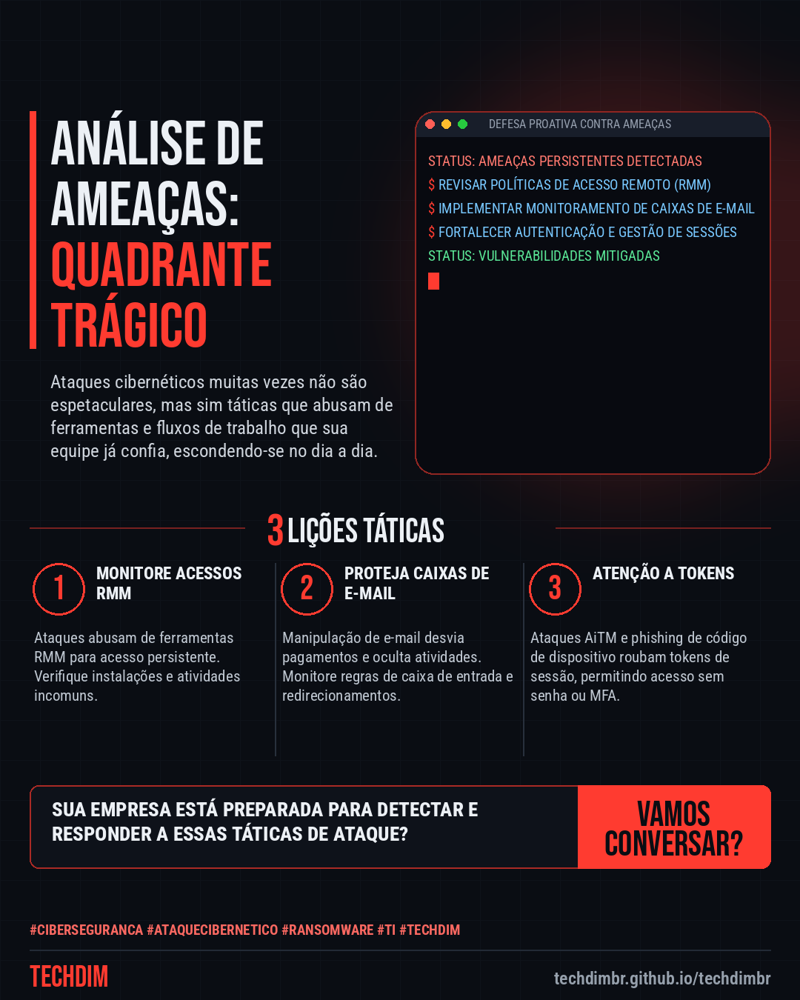
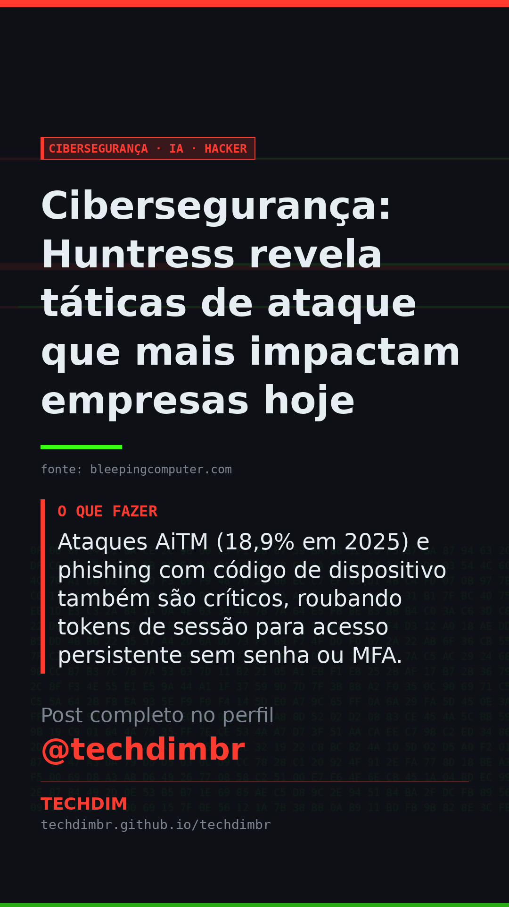

# Cibersegurança · IA · Hacker — Cibersegurança: Huntress revela táticas de ataque que mais impactam empresas hoje

- **Data:** 2026-10-27, 16:23 (horário de Brasília)
- **Curadoria:** Claude (Routine) — pauta do dia
- **Execução no Actions:** https://github.com/Techdimbr/Publi-midia-Techdim/actions/runs/40568461352
- **Por que esta pauta:** Entender as táticas de ataque mais eficazes é crucial para priorizar defesas e proteger sua infraestrutura de TI.

## Resultado

| Rede | Status | Link | 1º comentário |
|---|---|---|---|
| linkedin | ✅ publicado | https://www.linkedin.com/feed/update/urn:li:share:7520927998766800896/ | — |
| facebook | ✅ publicado | https://www.facebook.com/122132402349390486/posts/122138928387390486 | ✅ |
| instagram | ✅ publicado | https://www.instagram.com/p/DfAmWarmPFk/ | ✅ |
| Stories | ✅ publicado | https://www.instagram.com/stories/techdimbr/4017379704206525747 | — |

## Fontes

- [bleepingcomputer.com](https://www.bleepingcomputer.com/news/security/the-huntress-tragic-quadrant-ranking-threats-hitting-businesses-hardest/)

## Linkedin

```text
Cibersegurança: Huntress revela táticas de ataque que mais impactam empresas hoje

01. A Huntress, empresa de cibersegurança, ranqueou as táticas de ataque que mais causam impacto em empresas, focando no abuso de ferramentas e fluxos de trabalho confiáveis.
02. Abuso de ferramentas RMM (45% dos incidentes em Q1 2026) e manipulação de caixas de e-mail (24,6% dos sinais ITDR em 2026) são as principais ameaças.
03. Ataques AiTM (18,9% em 2025) e phishing com código de dispositivo também são críticos, roubando tokens de sessão para acesso persistente sem senha ou MFA.

A TECHDIM oferece soluções de cibersegurança defensiva para proteger sua empresa contra essas e outras ameaças persistentes e emergentes.

Fontes: https://www.bleepingcomputer.com/news/security/the-huntress-tragic-quadrant-ranking-threats-hitting-businesses-hardest/

TECHDIM — Infraestrutura · Segurança · IA
https://techdimbr.github.io/techdimbr/

#Ciberseguranca #AtaqueCibernetico #Ransomware #TI #TECHDIM
```



## Facebook

```text
Cibersegurança: Huntress revela táticas de ataque que mais impactam empresas hoje

• A Huntress, empresa de cibersegurança, ranqueou as táticas de ataque que mais causam impacto em empresas, focando no abuso de ferramentas e fluxos de trabalho confiáveis.
• Abuso de ferramentas RMM (45% dos incidentes em Q1 2026) e manipulação de caixas de e-mail (24,6% dos sinais ITDR em 2026) são as principais ameaças.
• Ataques AiTM (18,9% em 2025) e phishing com código de dispositivo também são críticos, roubando tokens de sessão para acesso persistente sem senha ou MFA.

A TECHDIM oferece soluções de cibersegurança defensiva para proteger sua empresa contra essas e outras ameaças persistentes e emergentes.

Fale com a TECHDIM — fontes e site no primeiro comentário 👇

#Ciberseguranca #AtaqueCibernetico #Ransomware #TECHDIM
```

Primeiro comentário:

```text
📎 Fontes:
• bleepingcomputer.com: https://www.bleepingcomputer.com/news/security/the-huntress-tragic-quadrant-ranking-threats-hitting-businesses-hardest/

🌐 TECHDIM — Infraestrutura · Segurança · IA: https://techdimbr.github.io/techdimbr/
```


## Instagram

```text
Cibersegurança: Huntress revela táticas de ataque que mais impactam empresas hoje

1️⃣ A Huntress, empresa de cibersegurança, ranqueou as táticas de ataque que mais causam impacto em empresas, focando no abuso de ferramentas e fluxos de trabalho confiáveis.
2️⃣ Abuso de ferramentas RMM (45% dos incidentes em Q1 2026) e manipulação de caixas de e-mail (24,6% dos sinais ITDR em 2026) são as principais ameaças.
3️⃣ Ataques AiTM (18,9% em 2025) e phishing com código de dispositivo também são críticos, roubando tokens de sessão para acesso persistente sem senha ou MFA.

A TECHDIM oferece soluções de cibersegurança defensiva para proteger sua empresa contra essas e outras ameaças persistentes e emergentes.

🔗 Link na bio: techdimbr.github.io/techdimbr
Fontes no primeiro comentário 👇

#ciberseguranca #ataquecibernetico #ransomware #ti #techdim #seguranca #hacker #infraestrutura
```

Primeiro comentário:

```text
📎 Fontes: bleepingcomputer.com
```


## Stories


