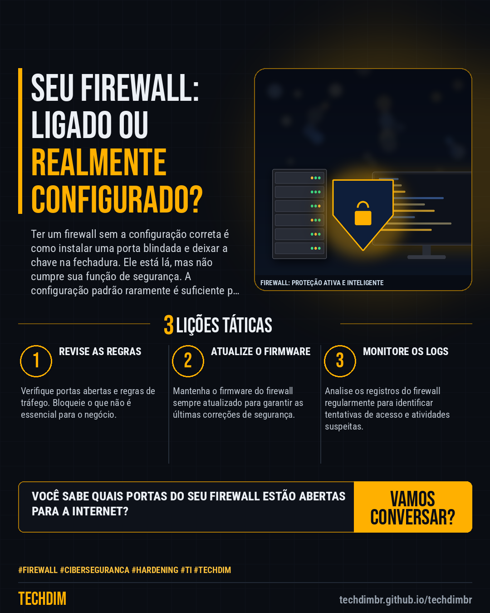

# Conhecimento — Firewall: Seu firewall está configurado ou só ligado? Não basta ter, precisa proteger.

- **Data:** 2026-10-27, 18:23 (horário de Brasília)
- **Curadoria:** Claude (Routine) — pauta do dia
- **Execução no Actions:** https://github.com/Techdimbr/Publi-midia-Techdim/actions/runs/40586283959
- **Por que esta pauta:** Configurar corretamente o firewall é uma medida de segurança fundamental para qualquer empresa hoje.

## Resultado

| Rede | Status | Link | 1º comentário |
|---|---|---|---|
| linkedin | ✅ publicado | https://www.linkedin.com/feed/update/urn:li:share:7520958317314109440/ | — |
| facebook | ✅ publicado | https://www.facebook.com/122132402349390486/posts/122138948025390486 | ✅ |
| instagram | ✅ publicado | https://www.instagram.com/p/DfA0JSWjCko/ | — |

## Linkedin

```text
Firewall: Seu firewall está configurado ou só ligado? Não basta ter, precisa proteger.

01. Muitas PMEs investem em firewall, mas o deixam com configurações padrão, que não bloqueiam ameaças avançadas.
02. Um firewall configurado corretamente é uma barreira ativa, filtrando tráfego e detectando intrusões em tempo real.
03. Sem a configuração adequada, sua rede fica exposta a acessos não autorizados e ataques cibernéticos.

A TECHDIM atua na configuração e gestão de firewalls, garantindo que sua proteção esteja sempre ativa e otimizada.

TECHDIM — Infraestrutura · Segurança · IA
https://techdimbr.github.io/techdimbr/

#Firewall #Ciberseguranca #Hardening #TI #TECHDIM
```



## Facebook

```text
Firewall: Seu firewall está configurado ou só ligado? Não basta ter, precisa proteger.

• Muitas PMEs investem em firewall, mas o deixam com configurações padrão, que não bloqueiam ameaças avançadas.
• Um firewall configurado corretamente é uma barreira ativa, filtrando tráfego e detectando intrusões em tempo real.
• Sem a configuração adequada, sua rede fica exposta a acessos não autorizados e ataques cibernéticos.

A TECHDIM atua na configuração e gestão de firewalls, garantindo que sua proteção esteja sempre ativa e otimizada.

Fale com a TECHDIM — link no primeiro comentário 👇

#Firewall #Ciberseguranca #Hardening #TECHDIM
```

Primeiro comentário:

```text
🌐 TECHDIM — Infraestrutura · Segurança · IA: https://techdimbr.github.io/techdimbr/
```


## Instagram

```text
Firewall: Seu firewall está configurado ou só ligado? Não basta ter, precisa proteger.

1️⃣ Muitas PMEs investem em firewall, mas o deixam com configurações padrão, que não bloqueiam ameaças avançadas.
2️⃣ Um firewall configurado corretamente é uma barreira ativa, filtrando tráfego e detectando intrusões em tempo real.
3️⃣ Sem a configuração adequada, sua rede fica exposta a acessos não autorizados e ataques cibernéticos.

A TECHDIM atua na configuração e gestão de firewalls, garantindo que sua proteção esteja sempre ativa e otimizada.

🔗 Link na bio: techdimbr.github.io/techdimbr

#firewall #ciberseguranca #hardening #ti #techdim #conhecimento #aprendati #tecnologia
```


