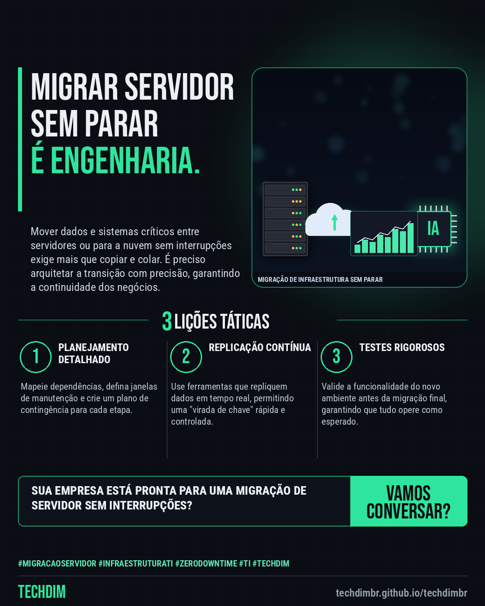

# TECHDIM · Serviços — Migração de servidor: leve seus dados sem interromper a operação da empresa

- **Data:** 2026-10-27, 20:52 (horário de Brasília)
- **Curadoria:** Claude (Routine) — pauta do dia
- **Execução no Actions:** https://github.com/Techdimbr/Publi-midia-Techdim/actions/runs/40604988514
- **Por que esta pauta:** A migração de servidores é um desafio constante para PMEs que buscam modernizar sua TI sem interrupções.

## Resultado

| Rede | Status | Link | 1º comentário |
|---|---|---|---|
| linkedin | ✅ publicado | https://www.linkedin.com/feed/update/urn:li:share:7520995842699198464/ | — |
| facebook | ✅ publicado | https://www.facebook.com/122132402349390486/posts/122138965005390486 | ✅ |
| instagram | ✅ publicado | https://www.instagram.com/p/DfBFMz7mH5i/ | — |

## Linkedin

```text
Migração de servidor: leve seus dados sem interromper a operação da empresa

01. Muitas empresas adiam a migração de servidores por medo de paradas prolongadas e perda de dados, um risco real sem planejamento e execução adequados.
02. A engenharia da TECHDIM realiza migrações de servidores e ambientes de nuvem com estratégias de "zero downtime", minimizando qualquer impacto na produtividade.
03. Utilizamos métodos que permitem a replicação de dados em tempo real e testes pré-migração, garantindo a integridade e a disponibilidade dos sistemas críticos.

Não deixe a modernização de sua infraestrutura para depois. A TECHDIM garante uma transição segura e eficiente.

TECHDIM — Infraestrutura · Segurança · IA
https://techdimbr.github.io/techdimbr/

#MigracaoServidor #InfraestruturaTI #ZeroDowntime #TI #TECHDIM
```



## Facebook

```text
Migração de servidor: leve seus dados sem interromper a operação da empresa

• Muitas empresas adiam a migração de servidores por medo de paradas prolongadas e perda de dados, um risco real sem planejamento e execução adequados.
• A engenharia da TECHDIM realiza migrações de servidores e ambientes de nuvem com estratégias de "zero downtime", minimizando qualquer impacto na produtividade.
• Utilizamos métodos que permitem a replicação de dados em tempo real e testes pré-migração, garantindo a integridade e a disponibilidade dos sistemas críticos.

Não deixe a modernização de sua infraestrutura para depois. A TECHDIM garante uma transição segura e eficiente.

Fale com a TECHDIM — link no primeiro comentário 👇

#MigracaoServidor #InfraestruturaTI #ZeroDowntime #TECHDIM
```

Primeiro comentário:

```text
🌐 TECHDIM — Infraestrutura · Segurança · IA: https://techdimbr.github.io/techdimbr/
```


## Instagram

```text
Migração de servidor: leve seus dados sem interromper a operação da empresa

1️⃣ Muitas empresas adiam a migração de servidores por medo de paradas prolongadas e perda de dados, um risco real sem planejamento e execução adequados.
2️⃣ A engenharia da TECHDIM realiza migrações de servidores e ambientes de nuvem com estratégias de "zero downtime", minimizando qualquer impacto na produtividade.
3️⃣ Utilizamos métodos que permitem a replicação de dados em tempo real e testes pré-migração, garantindo a integridade e a disponibilidade dos sistemas críticos.

Não deixe a modernização de sua infraestrutura para depois. A TECHDIM garante uma transição segura e eficiente.

🔗 Link na bio: techdimbr.github.io/techdimbr

#migracaoservidor #infraestruturati #zerodowntime #ti #techdim #suportetecnico #ciberseguranca #automacao
```


