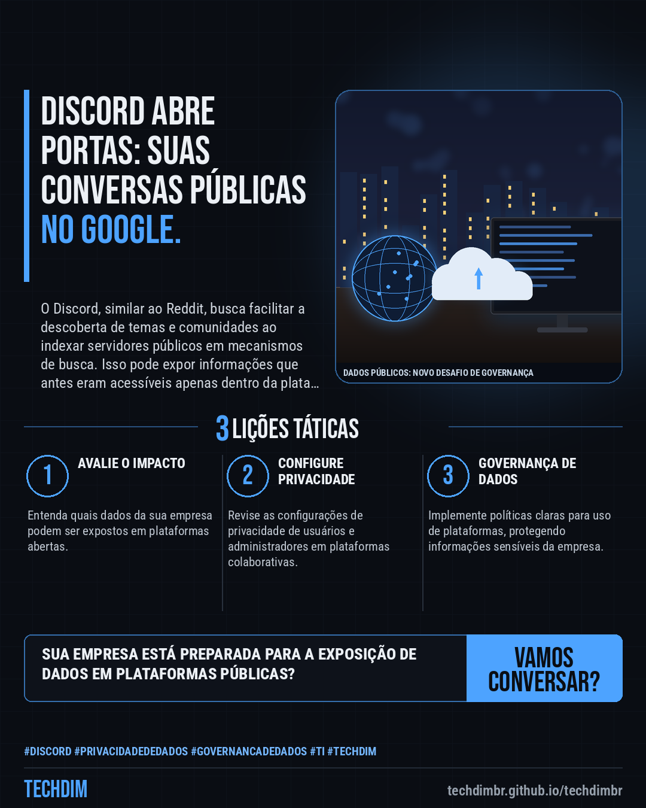
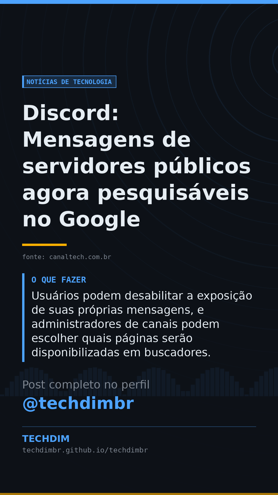

# Notícias de Tecnologia — Discord: Mensagens de servidores públicos agora pesquisáveis no Google

- **Data:** 2026-10-28, 14:10 (horário de Brasília)
- **Curadoria:** Claude (Routine) — pauta do dia
- **Execução no Actions:** https://github.com/Techdimbr/Publi-midia-Techdim/actions/runs/40732840180
- **Por que esta pauta:** Este assunto é relevante devido às implicações de privacidade e governança de dados para empresas que usam plataformas online.

## Resultado

| Rede | Status | Link | 1º comentário |
|---|---|---|---|
| linkedin | ✅ publicado | https://www.linkedin.com/feed/update/urn:li:share:7521256880854224896/ | — |
| facebook | ✅ publicado | https://www.facebook.com/122132402349390486/posts/122139116019390486 | ✅ |
| instagram | ✅ publicado | https://www.instagram.com/p/DfC754YGJKM/ | ✅ |
| Stories | ✅ publicado | https://www.instagram.com/stories/techdimbr/4018037371543521620 | — |

## Fontes

- [canaltech.com.br](https://canaltech.com.br/apps/discord-decide-abrir-conversas-dos-usuarios-e-mensagens-serao-buscaveis-no-google/)

## Linkedin

```text
Discord: Mensagens de servidores públicos agora pesquisáveis no Google

01. Discord passará a indexar mensagens de servidores públicos (tipo 'Descobrir') em mecanismos de busca, como o Google, a partir de dezembro.
02. A medida se aplica somente a servidores públicos com mais de mil participantes e regras de segurança específicas, não afetando grupos privados ou mensagens diretas.
03. Usuários podem desabilitar a exposição de suas próprias mensagens, e administradores de canais podem escolher quais páginas serão disponibilizadas em buscadores.

A gestão de privacidade em plataformas como Discord reforça a necessidade de governança de dados e cibersegurança defensiva em sua empresa.

Fontes: https://canaltech.com.br/apps/discord-decide-abrir-conversas-dos-usuarios-e-mensagens-serao-buscaveis-no-google/

TECHDIM — Infraestrutura · Segurança · IA
https://techdimbr.github.io/techdimbr/

#Discord #PrivacidadeDeDados #GovernancaDeDados #TI #TECHDIM
```



## Facebook

```text
Discord: Mensagens de servidores públicos agora pesquisáveis no Google

• Discord passará a indexar mensagens de servidores públicos (tipo 'Descobrir') em mecanismos de busca, como o Google, a partir de dezembro.
• A medida se aplica somente a servidores públicos com mais de mil participantes e regras de segurança específicas, não afetando grupos privados ou mensagens diretas.
• Usuários podem desabilitar a exposição de suas próprias mensagens, e administradores de canais podem escolher quais páginas serão disponibilizadas em buscadores.

A gestão de privacidade em plataformas como Discord reforça a necessidade de governança de dados e cibersegurança defensiva em sua empresa.

Fale com a TECHDIM — fontes e site no primeiro comentário 👇

#Discord #PrivacidadeDeDados #GovernancaDeDados #TECHDIM
```

Primeiro comentário:

```text
📎 Fontes:
• canaltech.com.br: https://canaltech.com.br/apps/discord-decide-abrir-conversas-dos-usuarios-e-mensagens-serao-buscaveis-no-google/

🌐 TECHDIM — Infraestrutura · Segurança · IA: https://techdimbr.github.io/techdimbr/
```


## Instagram

```text
Discord: Mensagens de servidores públicos agora pesquisáveis no Google

1️⃣ Discord passará a indexar mensagens de servidores públicos (tipo 'Descobrir') em mecanismos de busca, como o Google, a partir de dezembro.
2️⃣ A medida se aplica somente a servidores públicos com mais de mil participantes e regras de segurança específicas, não afetando grupos privados ou mensagens diretas.
3️⃣ Usuários podem desabilitar a exposição de suas próprias mensagens, e administradores de canais podem escolher quais páginas serão disponibilizadas em buscadores.

A gestão de privacidade em plataformas como Discord reforça a necessidade de governança de dados e cibersegurança defensiva em sua empresa.

🔗 Link na bio: techdimbr.github.io/techdimbr
Fontes no primeiro comentário 👇

#discord #privacidadededados #governancadedados #ti #techdim #tecnologia #inteligenciaartificial #ia
```

Primeiro comentário:

```text
📎 Fontes: canaltech.com.br
```


## Stories


