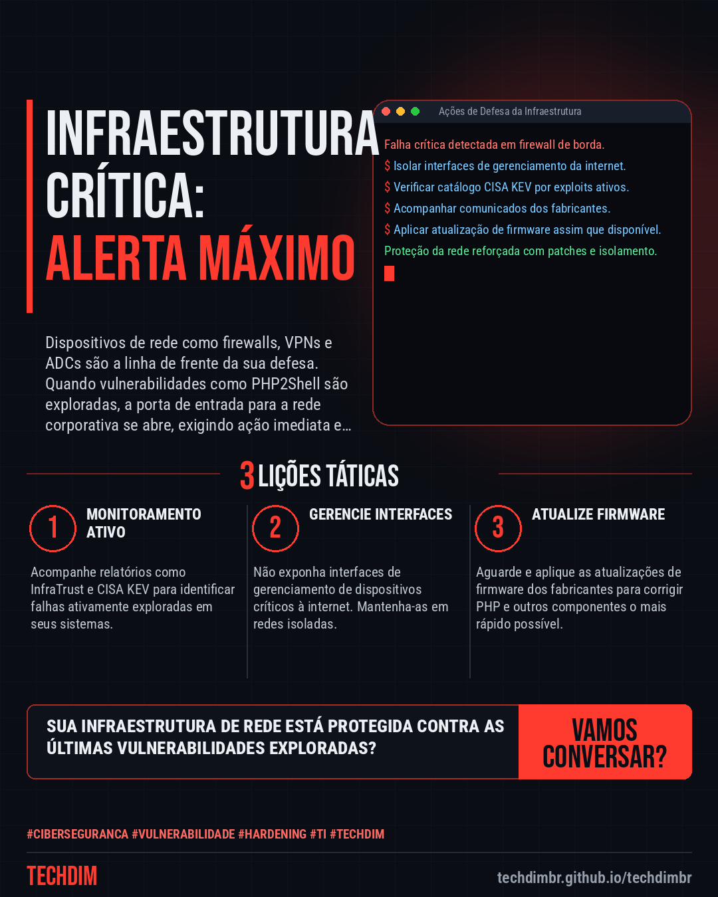
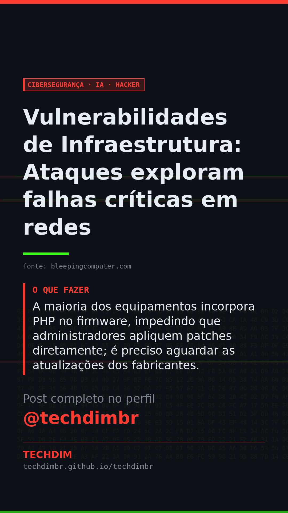

# Cibersegurança · IA · Hacker — Vulnerabilidades de Infraestrutura: Ataques exploram falhas críticas em redes

- **Data:** 2026-10-28, 16:29 (horário de Brasília)
- **Curadoria:** Claude (Routine) — pauta do dia
- **Execução no Actions:** https://github.com/Techdimbr/Publi-midia-Techdim/actions/runs/40754451165
- **Por que esta pauta:** Este assunto é crucial hoje devido à exploração ativa de falhas críticas em dispositivos de rede no Brasil e no mundo.

## Resultado

| Rede | Status | Link | 1º comentário |
|---|---|---|---|
| linkedin | ✅ publicado | https://www.linkedin.com/feed/update/urn:li:share:7521291844048232448/ | — |
| facebook | ✅ publicado | https://www.facebook.com/122132402349390486/posts/122139139131390486 | ✅ |
| instagram | ✅ publicado | https://www.instagram.com/p/DfDLzjgGHrc/ | ✅ |
| Stories | ✅ publicado | https://www.instagram.com/stories/techdimbr/4018107315673118258 | — |

## Fontes

- [bleepingcomputer.com](https://www.bleepingcomputer.com/news/security/infratrust-report-warns-of-exploited-flaws-in-critical-network-infrastructure/)

## Linkedin

```text
Vulnerabilidades de Infraestrutura: Ataques exploram falhas críticas em redes

01. Atacantes estão explorando ativamente vulnerabilidades em infraestruturas de rede críticas, como firewalls e VPNs, através de falhas PHP2Shell em interfaces de gerenciamento.
02. O relatório InfraTrust identificou 133 novos alertas de segurança, com 37 críticos e 58 exploráveis remotamente sem autenticação, incluindo 16 falhas já no catálogo KEV da CISA.
03. A maioria dos equipamentos incorpora PHP no firmware, impedindo que administradores apliquem patches diretamente; é preciso aguardar as atualizações dos fabricantes.

A TECHDIM protege sua infraestrutura crítica contra ameaças ativas com serviços avançados de cibersegurança defensiva.

Fontes: https://www.bleepingcomputer.com/news/security/infratrust-report-warns-of-exploited-flaws-in-critical-network-infrastructure/

TECHDIM — Infraestrutura · Segurança · IA
https://techdimbr.github.io/techdimbr/

#Ciberseguranca #Vulnerabilidade #Hardening #TI #TECHDIM
```



## Facebook

```text
Vulnerabilidades de Infraestrutura: Ataques exploram falhas críticas em redes

• Atacantes estão explorando ativamente vulnerabilidades em infraestruturas de rede críticas, como firewalls e VPNs, através de falhas PHP2Shell em interfaces de gerenciamento.
• O relatório InfraTrust identificou 133 novos alertas de segurança, com 37 críticos e 58 exploráveis remotamente sem autenticação, incluindo 16 falhas já no catálogo KEV da CISA.
• A maioria dos equipamentos incorpora PHP no firmware, impedindo que administradores apliquem patches diretamente; é preciso aguardar as atualizações dos fabricantes.

A TECHDIM protege sua infraestrutura crítica contra ameaças ativas com serviços avançados de cibersegurança defensiva.

Fale com a TECHDIM — fontes e site no primeiro comentário 👇

#Ciberseguranca #Vulnerabilidade #Hardening #TECHDIM
```

Primeiro comentário:

```text
📎 Fontes:
• bleepingcomputer.com: https://www.bleepingcomputer.com/news/security/infratrust-report-warns-of-exploited-flaws-in-critical-network-infrastructure/

🌐 TECHDIM — Infraestrutura · Segurança · IA: https://techdimbr.github.io/techdimbr/
```


## Instagram

```text
Vulnerabilidades de Infraestrutura: Ataques exploram falhas críticas em redes

1️⃣ Atacantes estão explorando ativamente vulnerabilidades em infraestruturas de rede críticas, como firewalls e VPNs, através de falhas PHP2Shell em interfaces de gerenciamento.
2️⃣ O relatório InfraTrust identificou 133 novos alertas de segurança, com 37 críticos e 58 exploráveis remotamente sem autenticação, incluindo 16 falhas já no catálogo KEV da CISA.
3️⃣ A maioria dos equipamentos incorpora PHP no firmware, impedindo que administradores apliquem patches diretamente; é preciso aguardar as atualizações dos fabricantes.

A TECHDIM protege sua infraestrutura crítica contra ameaças ativas com serviços avançados de cibersegurança defensiva.

🔗 Link na bio: techdimbr.github.io/techdimbr
Fontes no primeiro comentário 👇

#ciberseguranca #vulnerabilidade #hardening #ti #techdim #seguranca #hacker #infraestrutura
```

Primeiro comentário:

```text
📎 Fontes: bleepingcomputer.com
```


## Stories


