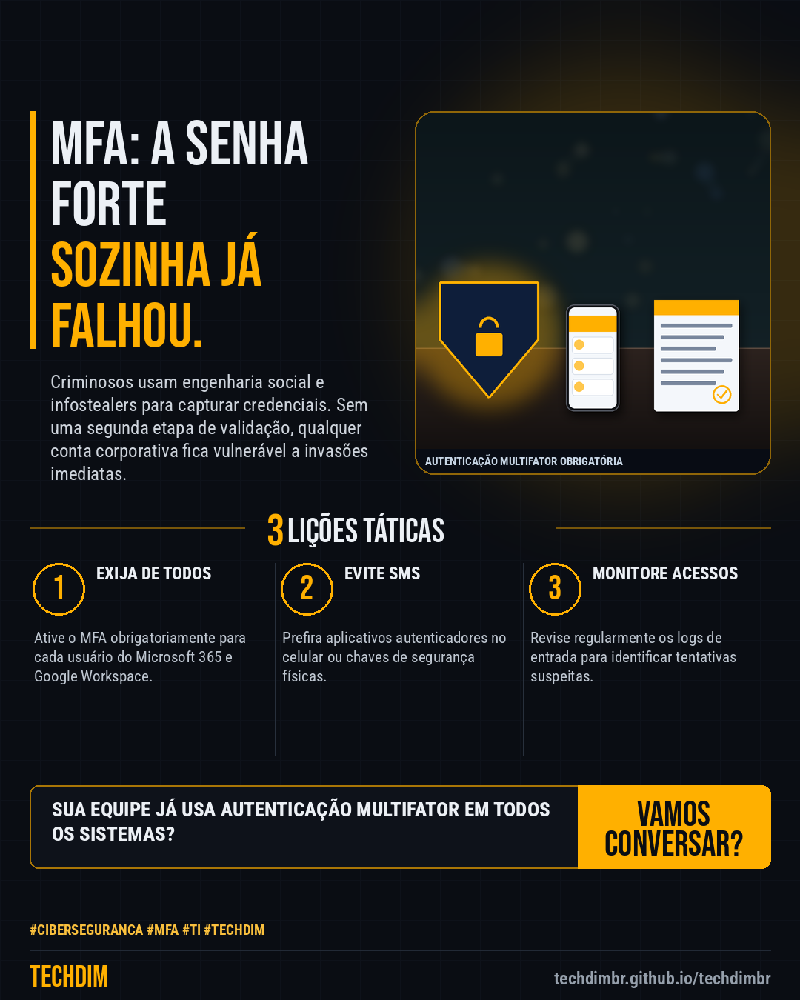

# Conhecimento — MFA obrigatório: por que senha forte já não basta na sua empresa

- **Data:** 2026-10-28, 18:43 (horário de Brasília)
- **Curadoria:** Claude (Routine) — pauta do dia
- **Execução no Actions:** https://github.com/Techdimbr/Publi-midia-Techdim/actions/runs/40774207782
- **Por que esta pauta:** Ataques de credential stuffing e roubo de senhas continuam liderando incidentes em PMEs.

## Resultado

| Rede | Status | Link | 1º comentário |
|---|---|---|---|
| linkedin | ✅ publicado | https://www.linkedin.com/feed/update/urn:li:share:7521325762961125376/ | — |
| facebook | ✅ publicado | https://www.facebook.com/122132402349390486/posts/122139157233390486 | ✅ |
| instagram | ✅ publicado | https://www.instagram.com/p/DfDbOs3jcLQ/ | — |

## Linkedin

```text
MFA obrigatório: por que senha forte já não basta na sua empresa

01. Senhas complexas caem em phishing e vazamentos corporativos, tornando a autenticação multifator indispensável para bloquear invasões.
02. A ativação do MFA exige uma segunda forma de confirmação, como aplicativo authenticator ou chave física, a cada acesso crítico.
03. Gerenciar identidades com barreiras adicionais protege dados de clientes e sistemas contra acessos não autorizados.

A TECHDIM implementa políticas de acesso e MFA para blindar sua operação corporativa.

TECHDIM — Infraestrutura · Segurança · IA
https://techdimbr.github.io/techdimbr/

#Ciberseguranca #MFA #TI #TECHDIM #Conhecimento
```



## Facebook

```text
MFA obrigatório: por que senha forte já não basta na sua empresa

• Senhas complexas caem em phishing e vazamentos corporativos, tornando a autenticação multifator indispensável para bloquear invasões.
• A ativação do MFA exige uma segunda forma de confirmação, como aplicativo authenticator ou chave física, a cada acesso crítico.
• Gerenciar identidades com barreiras adicionais protege dados de clientes e sistemas contra acessos não autorizados.

A TECHDIM implementa políticas de acesso e MFA para blindar sua operação corporativa.

Fale com a TECHDIM — link no primeiro comentário 👇

#Ciberseguranca #MFA #TI #TECHDIM
```

Primeiro comentário:

```text
🌐 TECHDIM — Infraestrutura · Segurança · IA: https://techdimbr.github.io/techdimbr/
```


## Instagram

```text
MFA obrigatório: por que senha forte já não basta na sua empresa

1️⃣ Senhas complexas caem em phishing e vazamentos corporativos, tornando a autenticação multifator indispensável para bloquear invasões.
2️⃣ A ativação do MFA exige uma segunda forma de confirmação, como aplicativo authenticator ou chave física, a cada acesso crítico.
3️⃣ Gerenciar identidades com barreiras adicionais protege dados de clientes e sistemas contra acessos não autorizados.

A TECHDIM implementa políticas de acesso e MFA para blindar sua operação corporativa.

🔗 Link na bio: techdimbr.github.io/techdimbr

#ciberseguranca #mfa #ti #techdim #conhecimento #aprendati #tecnologia #campinas
```


