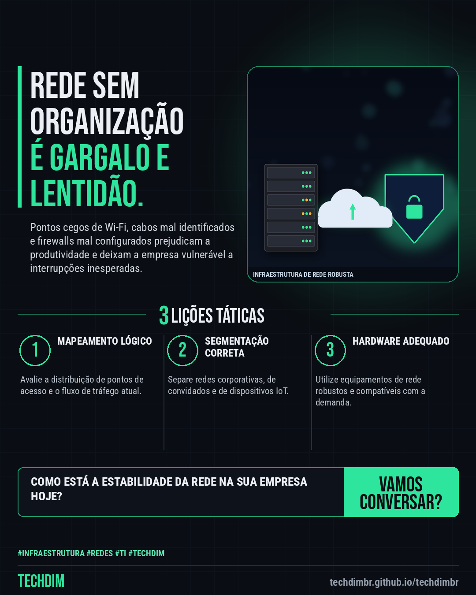

# TECHDIM · Serviços — Infraestrutura e redes: Wi-Fi, firewall e cabeamento organizados para sua empresa

- **Data:** 2026-10-28, 21:06 (horário de Brasília)
- **Curadoria:** Claude (Routine) — pauta do dia
- **Execução no Actions:** https://github.com/Techdimbr/Publi-midia-Techdim/actions/runs/40791684812
- **Por que esta pauta:** Organizar a infraestrutura de redes previne falhas de conectividade e mitiga brechas de segurança operacionais.

## Resultado

| Rede | Status | Link | 1º comentário |
|---|---|---|---|
| linkedin | ✅ publicado | https://www.linkedin.com/feed/update/urn:li:share:7521361549744168960/ | — |
| facebook | ✅ publicado | https://www.facebook.com/122132402349390486/posts/122139176229390486 | ✅ |
| instagram | ✅ publicado | https://www.instagram.com/p/DfDrgNwlDiU/ | — |

## Linkedin

```text
Infraestrutura e redes: Wi-Fi, firewall e cabeamento organizados para sua empresa

01. Redes instáveis e pontos cegos de Wi-Fi travam o atendimento e geram frustração na equipe todos os dias.
02. A TECHDIM projeta e organiza a infraestrutura física e lógica para garantir alta disponibilidade e tráfego seguro.
03. Com uma arquitetura de rede estruturada, sua empresa ganha performance, previsibilidade e bases sólidas para crescer.

Conte com a engenharia da TECHDIM para estruturar a rede da sua empresa. Visite techdimbr.github.io/techdimbr

TECHDIM — Infraestrutura · Segurança · IA
https://techdimbr.github.io/techdimbr/

#Infraestrutura #Redes #TI #TECHDIM #InfraestruturaDeTI
```



## Facebook

```text
Infraestrutura e redes: Wi-Fi, firewall e cabeamento organizados para sua empresa

• Redes instáveis e pontos cegos de Wi-Fi travam o atendimento e geram frustração na equipe todos os dias.
• A TECHDIM projeta e organiza a infraestrutura física e lógica para garantir alta disponibilidade e tráfego seguro.
• Com uma arquitetura de rede estruturada, sua empresa ganha performance, previsibilidade e bases sólidas para crescer.

Conte com a engenharia da TECHDIM para estruturar a rede da sua empresa. Visite techdimbr.github.io/techdimbr

Fale com a TECHDIM — link no primeiro comentário 👇

#Infraestrutura #Redes #TI #TECHDIM
```

Primeiro comentário:

```text
🌐 TECHDIM — Infraestrutura · Segurança · IA: https://techdimbr.github.io/techdimbr/
```


## Instagram

```text
Infraestrutura e redes: Wi-Fi, firewall e cabeamento organizados para sua empresa

1️⃣ Redes instáveis e pontos cegos de Wi-Fi travam o atendimento e geram frustração na equipe todos os dias.
2️⃣ A TECHDIM projeta e organiza a infraestrutura física e lógica para garantir alta disponibilidade e tráfego seguro.
3️⃣ Com uma arquitetura de rede estruturada, sua empresa ganha performance, previsibilidade e bases sólidas para crescer.

Conte com a engenharia da TECHDIM para estruturar a rede da sua empresa. Visite techdimbr.github.io/techdimbr

🔗 Link na bio: techdimbr.github.io/techdimbr

#infraestrutura #redes #ti #techdim #suportetecnico #ciberseguranca #automacao #campinas
```


