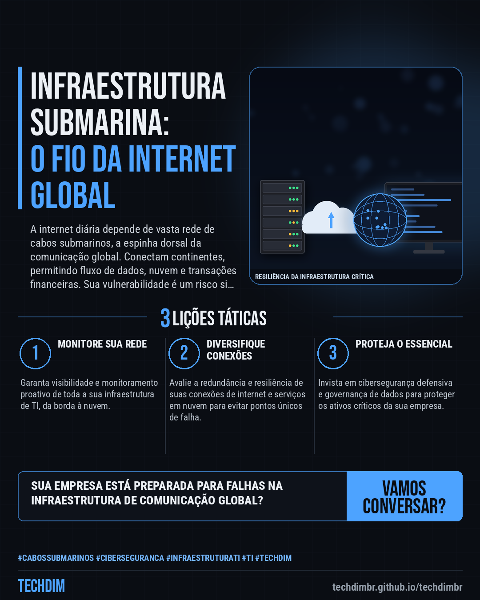
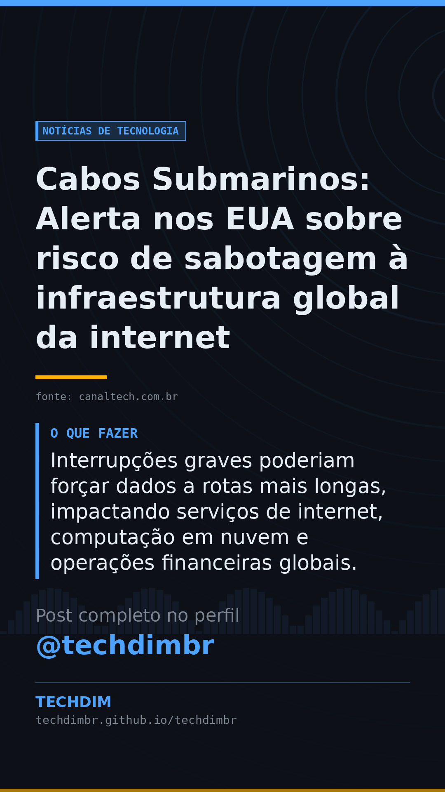

# Notícias de Tecnologia — Cabos Submarinos: Alerta nos EUA sobre risco de sabotagem à infraestrutura global da internet

- **Data:** 2026-10-29, 14:25 (horário de Brasília)
- **Curadoria:** Claude (Routine) — pauta do dia
- **Execução no Actions:** https://github.com/Techdimbr/Publi-midia-Techdim/actions/runs/40920965870
- **Por que esta pauta:** Este alerta sublinha a importância estratégica da proteção da infraestrutura de rede global para empresas brasileiras.

## Resultado

| Rede | Status | Link | 1º comentário |
|---|---|---|---|
| linkedin | ✅ publicado | https://www.linkedin.com/feed/update/urn:li:share:7521623061251592193/ | — |
| facebook | ✅ publicado | https://www.facebook.com/122132402349390486/posts/122139322149390486 | ✅ |
| instagram | ✅ publicado | https://www.instagram.com/p/DfFibWmD27b/ | ✅ |
| Stories | ✅ publicado | https://www.instagram.com/stories/techdimbr/4018769754609124644 | — |

## Fontes

- [canaltech.com.br](https://canaltech.com.br/telecom/navios-chineses-rondam-cabos-de-google-e-meta-e-acendem-alerta-nos-eua/)

## Linkedin

```text
Cabos Submarinos: Alerta nos EUA sobre risco de sabotagem à infraestrutura global da internet

01. Navios chineses próximos a cabos submarinos no Pacífico acendem alerta nos EUA sobre possível sabotagem à infraestrutura que sustenta parte crucial da internet mundial.
02. Relatório da Comissão de Revisão Econômica e de Segurança EUA-China (USCC) avalia pontos frágeis e capacidades de uso duplo, como submersíveis, da China.
03. Interrupções graves poderiam forçar dados a rotas mais longas, impactando serviços de internet, computação em nuvem e operações financeiras globais.

Proteger a infraestrutura crítica é vital para a continuidade dos negócios. A TECHDIM oferece soluções robustas de cibersegurança e TI.

Fontes: https://canaltech.com.br/telecom/navios-chineses-rondam-cabos-de-google-e-meta-e-acendem-alerta-nos-eua/

TECHDIM — Infraestrutura · Segurança · IA
https://techdimbr.github.io/techdimbr/

#CabosSubmarinos #Ciberseguranca #InfraestruturaTI #TI #TECHDIM
```



## Facebook

```text
Cabos Submarinos: Alerta nos EUA sobre risco de sabotagem à infraestrutura global da internet

• Navios chineses próximos a cabos submarinos no Pacífico acendem alerta nos EUA sobre possível sabotagem à infraestrutura que sustenta parte crucial da internet mundial.
• Relatório da Comissão de Revisão Econômica e de Segurança EUA-China (USCC) avalia pontos frágeis e capacidades de uso duplo, como submersíveis, da China.
• Interrupções graves poderiam forçar dados a rotas mais longas, impactando serviços de internet, computação em nuvem e operações financeiras globais.

Proteger a infraestrutura crítica é vital para a continuidade dos negócios. A TECHDIM oferece soluções robustas de cibersegurança e TI.

Fale com a TECHDIM — fontes e site no primeiro comentário 👇

#CabosSubmarinos #Ciberseguranca #InfraestruturaTI #TECHDIM
```

Primeiro comentário:

```text
📎 Fontes:
• canaltech.com.br: https://canaltech.com.br/telecom/navios-chineses-rondam-cabos-de-google-e-meta-e-acendem-alerta-nos-eua/

🌐 TECHDIM — Infraestrutura · Segurança · IA: https://techdimbr.github.io/techdimbr/
```


## Instagram

```text
Cabos Submarinos: Alerta nos EUA sobre risco de sabotagem à infraestrutura global da internet

1️⃣ Navios chineses próximos a cabos submarinos no Pacífico acendem alerta nos EUA sobre possível sabotagem à infraestrutura que sustenta parte crucial da internet mundial.
2️⃣ Relatório da Comissão de Revisão Econômica e de Segurança EUA-China (USCC) avalia pontos frágeis e capacidades de uso duplo, como submersíveis, da China.
3️⃣ Interrupções graves poderiam forçar dados a rotas mais longas, impactando serviços de internet, computação em nuvem e operações financeiras globais.

Proteger a infraestrutura crítica é vital para a continuidade dos negócios. A TECHDIM oferece soluções robustas de cibersegurança e TI.

🔗 Link na bio: techdimbr.github.io/techdimbr
Fontes no primeiro comentário 👇

#cabossubmarinos #ciberseguranca #infraestruturati #ti #techdim #tecnologia #inteligenciaartificial #ia
```

Primeiro comentário:

```text
📎 Fontes: canaltech.com.br
```


## Stories


