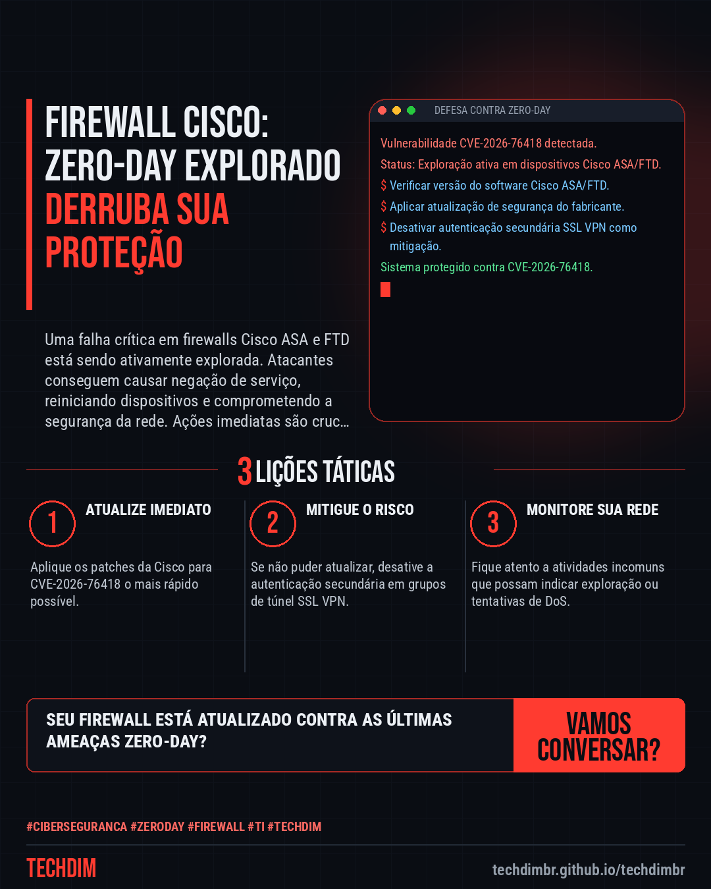
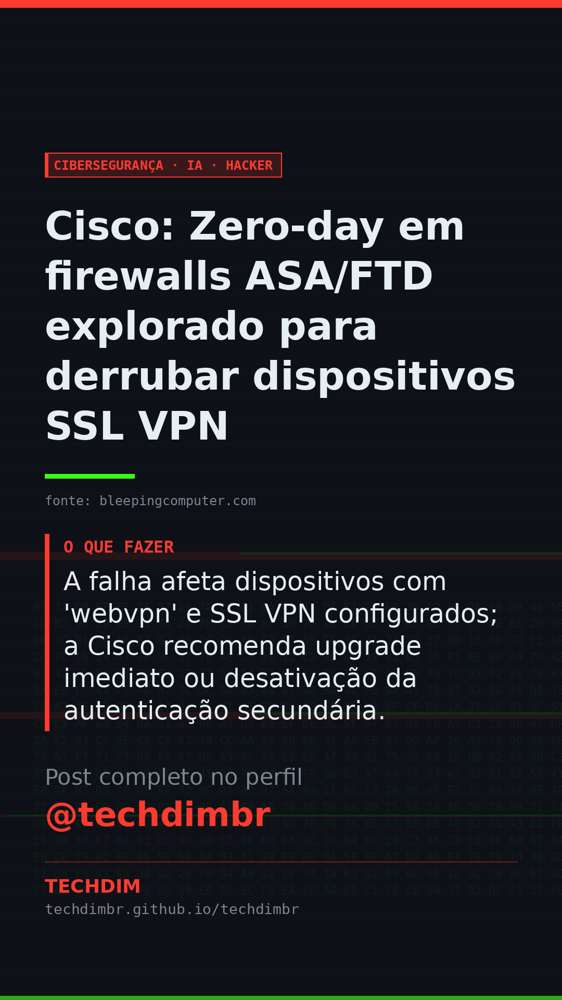

# Cibersegurança · IA · Hacker — Cisco: Zero-day em firewalls ASA/FTD explorado para derrubar dispositivos SSL VPN

- **Data:** 2026-10-29, 16:32 (horário de Brasília)
- **Curadoria:** Claude (Routine) — pauta do dia
- **Execução no Actions:** https://github.com/Techdimbr/Publi-midia-Techdim/actions/runs/40940863619
- **Por que esta pauta:** A exploração ativa de falhas críticas em firewalls exige atenção imediata para evitar interrupções operacionais.

## Resultado

| Rede | Status | Link | 1º comentário |
|---|---|---|---|
| linkedin | ✅ publicado | https://www.linkedin.com/feed/update/urn:li:share:7521655095025975298/ | — |
| facebook | ✅ publicado | https://www.facebook.com/122132402349390486/posts/122139339441390486 | ✅ |
| instagram | ✅ publicado | https://www.instagram.com/p/DfFw_UkDG0y/ | ✅ |
| Stories | ✅ publicado | https://www.instagram.com/stories/techdimbr/4018833820086730769 | — |

## Fontes

- [bleepingcomputer.com](https://www.bleepingcomputer.com/news/security/cisco-warns-of-firewall-zero-day-exploited-to-crash-ssl-vpn-devices/)

## Linkedin

```text
Cisco: Zero-day em firewalls ASA/FTD explorado para derrubar dispositivos SSL VPN

01. Cisco lança patches para CVE-2026-76418, uma vulnerabilidade zero-day de alta gravidade em firewalls ASA e FTD, já explorada ativamente.
02. A exploração permite que atacantes não autenticados causem condição de negação de serviço (DoS), forçando o reinício inesperado dos dispositivos.
03. A falha afeta dispositivos com 'webvpn' e SSL VPN configurados; a Cisco recomenda upgrade imediato ou desativação da autenticação secundária.

A TECHDIM atua na proteção de sua infraestrutura com cibersegurança defensiva, atualizando sistemas e monitorando vulnerabilidades.

Fontes: https://www.bleepingcomputer.com/news/security/cisco-warns-of-firewall-zero-day-exploited-to-crash-ssl-vpn-devices/

TECHDIM — Infraestrutura · Segurança · IA
https://techdimbr.github.io/techdimbr/

#Ciberseguranca #ZeroDay #Firewall #TI #TECHDIM
```



## Facebook

```text
Cisco: Zero-day em firewalls ASA/FTD explorado para derrubar dispositivos SSL VPN

• Cisco lança patches para CVE-2026-76418, uma vulnerabilidade zero-day de alta gravidade em firewalls ASA e FTD, já explorada ativamente.
• A exploração permite que atacantes não autenticados causem condição de negação de serviço (DoS), forçando o reinício inesperado dos dispositivos.
• A falha afeta dispositivos com 'webvpn' e SSL VPN configurados; a Cisco recomenda upgrade imediato ou desativação da autenticação secundária.

A TECHDIM atua na proteção de sua infraestrutura com cibersegurança defensiva, atualizando sistemas e monitorando vulnerabilidades.

Fale com a TECHDIM — fontes e site no primeiro comentário 👇

#Ciberseguranca #ZeroDay #Firewall #TECHDIM
```

Primeiro comentário:

```text
📎 Fontes:
• bleepingcomputer.com: https://www.bleepingcomputer.com/news/security/cisco-warns-of-firewall-zero-day-exploited-to-crash-ssl-vpn-devices/

🌐 TECHDIM — Infraestrutura · Segurança · IA: https://techdimbr.github.io/techdimbr/
```


## Instagram

```text
Cisco: Zero-day em firewalls ASA/FTD explorado para derrubar dispositivos SSL VPN

1️⃣ Cisco lança patches para CVE-2026-76418, uma vulnerabilidade zero-day de alta gravidade em firewalls ASA e FTD, já explorada ativamente.
2️⃣ A exploração permite que atacantes não autenticados causem condição de negação de serviço (DoS), forçando o reinício inesperado dos dispositivos.
3️⃣ A falha afeta dispositivos com 'webvpn' e SSL VPN configurados; a Cisco recomenda upgrade imediato ou desativação da autenticação secundária.

A TECHDIM atua na proteção de sua infraestrutura com cibersegurança defensiva, atualizando sistemas e monitorando vulnerabilidades.

🔗 Link na bio: techdimbr.github.io/techdimbr
Fontes no primeiro comentário 👇

#ciberseguranca #zeroday #firewall #ti #techdim #seguranca #hacker #infraestrutura
```

Primeiro comentário:

```text
📎 Fontes: bleepingcomputer.com
```


## Stories


