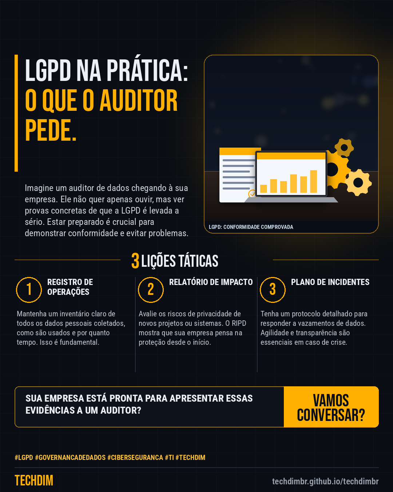

# Conhecimento — LGPD na prática: 4 itens que o auditor de dados pede primeiro na sua PME

- **Data:** 2026-10-29, 18:51 (horário de Brasília)
- **Curadoria:** Claude (Routine) — pauta do dia
- **Execução no Actions:** https://github.com/Techdimbr/Publi-midia-Techdim/actions/runs/40961198128
- **Por que esta pauta:** Entender o que um auditor busca é crucial para preparar sua PME para a LGPD e evitar multas.

## Resultado

| Rede | Status | Link | 1º comentário |
|---|---|---|---|
| linkedin | ✅ publicado | https://www.linkedin.com/feed/update/urn:li:share:7521690194606018561/ | — |
| facebook | ✅ publicado | https://www.facebook.com/122132402349390486/posts/122139359511390486 | ✅ |
| instagram | ✅ publicado | https://www.instagram.com/p/DfGA8zXDAYs/ | — |

## Linkedin

```text
LGPD na prática: 4 itens que o auditor de dados pede primeiro na sua PME

01. Auditorias de LGPD focam em evidências de conformidade, não apenas em políticas escritas. Prepare-se para mostrar como sua empresa protege dados.
02. Os primeiros itens solicitados incluem o registro de operações de tratamento, o relatório de impacto à proteção de dados (RIPD), o plano de resposta a incidentes e as evidências de treinamentos.
03. Apresentar esses documentos e processos de forma organizada e atualizada demonstra maturidade e compromisso com a proteção de dados pessoais.

A TECHDIM ajuda sua empresa a implementar processos e ferramentas que garantem a conformidade com a LGPD, protegendo seus dados e sua reputação.

TECHDIM — Infraestrutura · Segurança · IA
https://techdimbr.github.io/techdimbr/

#Lgpd #GovernancaDeDados #Ciberseguranca #TI #TECHDIM
```



## Facebook

```text
LGPD na prática: 4 itens que o auditor de dados pede primeiro na sua PME

• Auditorias de LGPD focam em evidências de conformidade, não apenas em políticas escritas. Prepare-se para mostrar como sua empresa protege dados.
• Os primeiros itens solicitados incluem o registro de operações de tratamento, o relatório de impacto à proteção de dados (RIPD), o plano de resposta a incidentes e as evidências de treinamentos.
• Apresentar esses documentos e processos de forma organizada e atualizada demonstra maturidade e compromisso com a proteção de dados pessoais.

A TECHDIM ajuda sua empresa a implementar processos e ferramentas que garantem a conformidade com a LGPD, protegendo seus dados e sua reputação.

Fale com a TECHDIM — link no primeiro comentário 👇

#Lgpd #GovernancaDeDados #Ciberseguranca #TECHDIM
```

Primeiro comentário:

```text
🌐 TECHDIM — Infraestrutura · Segurança · IA: https://techdimbr.github.io/techdimbr/
```


## Instagram

```text
LGPD na prática: 4 itens que o auditor de dados pede primeiro na sua PME

1️⃣ Auditorias de LGPD focam em evidências de conformidade, não apenas em políticas escritas. Prepare-se para mostrar como sua empresa protege dados.
2️⃣ Os primeiros itens solicitados incluem o registro de operações de tratamento, o relatório de impacto à proteção de dados (RIPD), o plano de resposta a incidentes e as evidências de treinamentos.
3️⃣ Apresentar esses documentos e processos de forma organizada e atualizada demonstra maturidade e compromisso com a proteção de dados pessoais.

A TECHDIM ajuda sua empresa a implementar processos e ferramentas que garantem a conformidade com a LGPD, protegendo seus dados e sua reputação.

🔗 Link na bio: techdimbr.github.io/techdimbr

#lgpd #governancadedados #ciberseguranca #ti #techdim #conhecimento #aprendati #tecnologia
```


