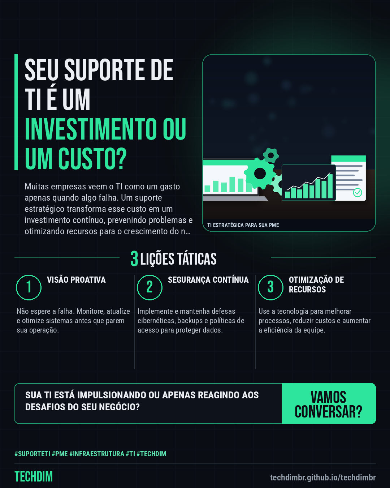

# TECHDIM · Serviços — Suporte de TI: Sua PME precisa de um time proativo, não de um 'quebra-galho'.

- **Data:** 2026-10-29, 21:01 (horário de Brasília)
- **Curadoria:** Claude (Routine) — pauta do dia
- **Execução no Actions:** https://github.com/Techdimbr/Publi-midia-Techdim/actions/runs/40976834469
- **Por que esta pauta:** PMEs precisam de TI robusta para competir, e o suporte adequado é a base para isso.

## Resultado

| Rede | Status | Link | 1º comentário |
|---|---|---|---|
| linkedin | ✅ publicado | https://www.linkedin.com/feed/update/urn:li:share:7521722690110648320/ | — |
| facebook | ✅ publicado | https://www.facebook.com/122132402349390486/posts/122139375375390486 | ✅ |
| instagram | ✅ publicado | https://www.instagram.com/p/DfGPud_l_ZT/ | — |

## Linkedin

```text
Suporte de TI: Sua PME precisa de um time proativo, não de um 'quebra-galho'.

01. Muitas PMEs enfrentam interrupções e lentidão por falta de um suporte de TI dedicado e estratégico, que vá além do reativo.
02. A ausência de manutenção preventiva e monitoramento constante leva a problemas recorrentes que impactam a produtividade e a segurança dos dados.
03. Um suporte especializado garante que a infraestrutura esteja otimizada, atualizada e pronta para as demandas do dia a dia, evitando surpresas.

A TECHDIM oferece suporte de TI proativo e estratégico, garantindo que sua operação se mantenha eficiente e segura, focada no seu negócio.

TECHDIM — Infraestrutura · Segurança · IA
https://techdimbr.github.io/techdimbr/

#SuporteTI #PME #Infraestrutura #TI #TECHDIM
```



## Facebook

```text
Suporte de TI: Sua PME precisa de um time proativo, não de um 'quebra-galho'.

• Muitas PMEs enfrentam interrupções e lentidão por falta de um suporte de TI dedicado e estratégico, que vá além do reativo.
• A ausência de manutenção preventiva e monitoramento constante leva a problemas recorrentes que impactam a produtividade e a segurança dos dados.
• Um suporte especializado garante que a infraestrutura esteja otimizada, atualizada e pronta para as demandas do dia a dia, evitando surpresas.

A TECHDIM oferece suporte de TI proativo e estratégico, garantindo que sua operação se mantenha eficiente e segura, focada no seu negócio.

Fale com a TECHDIM — link no primeiro comentário 👇

#SuporteTI #PME #Infraestrutura #TECHDIM
```

Primeiro comentário:

```text
🌐 TECHDIM — Infraestrutura · Segurança · IA: https://techdimbr.github.io/techdimbr/
```


## Instagram

```text
Suporte de TI: Sua PME precisa de um time proativo, não de um 'quebra-galho'.

1️⃣ Muitas PMEs enfrentam interrupções e lentidão por falta de um suporte de TI dedicado e estratégico, que vá além do reativo.
2️⃣ A ausência de manutenção preventiva e monitoramento constante leva a problemas recorrentes que impactam a produtividade e a segurança dos dados.
3️⃣ Um suporte especializado garante que a infraestrutura esteja otimizada, atualizada e pronta para as demandas do dia a dia, evitando surpresas.

A TECHDIM oferece suporte de TI proativo e estratégico, garantindo que sua operação se mantenha eficiente e segura, focada no seu negócio.

🔗 Link na bio: techdimbr.github.io/techdimbr

#suporteti #pme #infraestrutura #ti #techdim #suportetecnico #ciberseguranca #automacao
```


