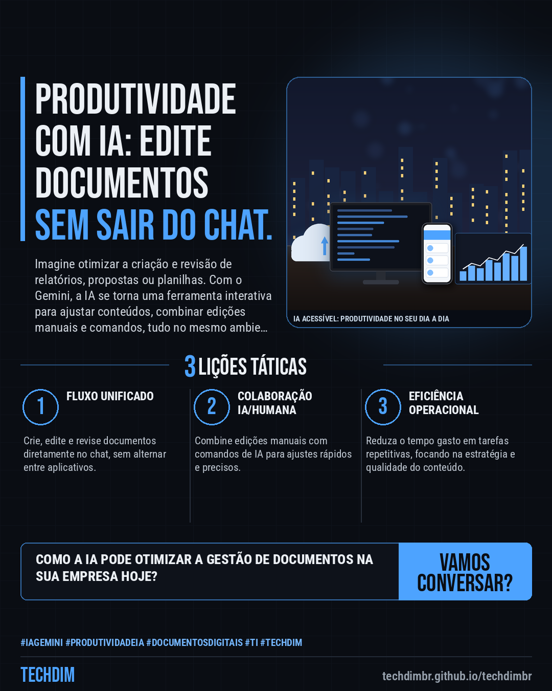

# Notícias de Tecnologia — IA Gemini: Edição interativa de documentos no chat otimiza fluxos de trabalho

- **Data:** 2026-10-30, 14:00 (horário de Brasília)
- **Curadoria:** Claude (Routine) — pauta do dia
- **Execução no Actions:** https://github.com/Techdimbr/Publi-midia-Techdim/actions/runs/41094859160
- **Por que esta pauta:** A integração de IA em ferramentas de produtividade redefine a eficiência operacional das empresas.

## Resultado

| Rede | Status | Link | 1º comentário |
|---|---|---|---|
| linkedin | ✅ publicado | https://www.linkedin.com/feed/update/urn:li:share:7521979314972790786/ | — |
| facebook | ✅ publicado | https://www.facebook.com/122132402349390486/posts/122139539229390486 | ✅ |
| instagram | ✅ publicado | https://www.instagram.com/p/DfIEbK0l-J3/ | ✅ |
| Stories | ✅ publicado | https://www.instagram.com/stories/techdimbr/4019482259317275494 | — |

## Fontes

- [canaltech.com.br](https://canaltech.com.br/inteligencia-artificial/sem-sair-do-chat-gemini-ganha-edicao-interativa-de-documentos-no-celular-e-na-web/)

## Linkedin

```text
IA Gemini: Edição interativa de documentos no chat otimiza fluxos de trabalho

01. Google Gemini agora permite criar, visualizar e editar documentos (PDFs, Docs, Sheets, apresentações) diretamente no chat, sem sair da interface.
02. Usuários podem fazer edições manuais e solicitar modificações à IA, combinando comandos de linguagem natural e ajustes diretos no conteúdo.
03. A versão web oferece suporte mais amplo (Docs, Sheets, Markdown, TXT, código) que a mobile (PDFs), já disponível em português para todos os usuários.

A TECHDIM otimiza sua infraestrutura e integra IA para impulsionar a produtividade e segurança da informação em sua PME.

Fontes: https://canaltech.com.br/inteligencia-artificial/sem-sair-do-chat-gemini-ganha-edicao-interativa-de-documentos-no-celular-e-na-web/

TECHDIM — Infraestrutura · Segurança · IA
https://techdimbr.github.io/techdimbr/

#IAGemini #ProdutividadeIA #DocumentosDigitais #TI #TECHDIM
```



## Facebook

```text
IA Gemini: Edição interativa de documentos no chat otimiza fluxos de trabalho

• Google Gemini agora permite criar, visualizar e editar documentos (PDFs, Docs, Sheets, apresentações) diretamente no chat, sem sair da interface.
• Usuários podem fazer edições manuais e solicitar modificações à IA, combinando comandos de linguagem natural e ajustes diretos no conteúdo.
• A versão web oferece suporte mais amplo (Docs, Sheets, Markdown, TXT, código) que a mobile (PDFs), já disponível em português para todos os usuários.

A TECHDIM otimiza sua infraestrutura e integra IA para impulsionar a produtividade e segurança da informação em sua PME.

Fale com a TECHDIM — fontes e site no primeiro comentário 👇

#IAGemini #ProdutividadeIA #DocumentosDigitais #TECHDIM
```

Primeiro comentário:

```text
📎 Fontes:
• canaltech.com.br: https://canaltech.com.br/inteligencia-artificial/sem-sair-do-chat-gemini-ganha-edicao-interativa-de-documentos-no-celular-e-na-web/

🌐 TECHDIM — Infraestrutura · Segurança · IA: https://techdimbr.github.io/techdimbr/
```


## Instagram

```text
IA Gemini: Edição interativa de documentos no chat otimiza fluxos de trabalho

1️⃣ Google Gemini agora permite criar, visualizar e editar documentos (PDFs, Docs, Sheets, apresentações) diretamente no chat, sem sair da interface.
2️⃣ Usuários podem fazer edições manuais e solicitar modificações à IA, combinando comandos de linguagem natural e ajustes diretos no conteúdo.
3️⃣ A versão web oferece suporte mais amplo (Docs, Sheets, Markdown, TXT, código) que a mobile (PDFs), já disponível em português para todos os usuários.

A TECHDIM otimiza sua infraestrutura e integra IA para impulsionar a produtividade e segurança da informação em sua PME.

🔗 Link na bio: techdimbr.github.io/techdimbr
Fontes no primeiro comentário 👇

#iagemini #produtividadeia #documentosdigitais #ti #techdim #tecnologia #inteligenciaartificial #ia
```

Primeiro comentário:

```text
📎 Fontes: canaltech.com.br
```


## Stories


