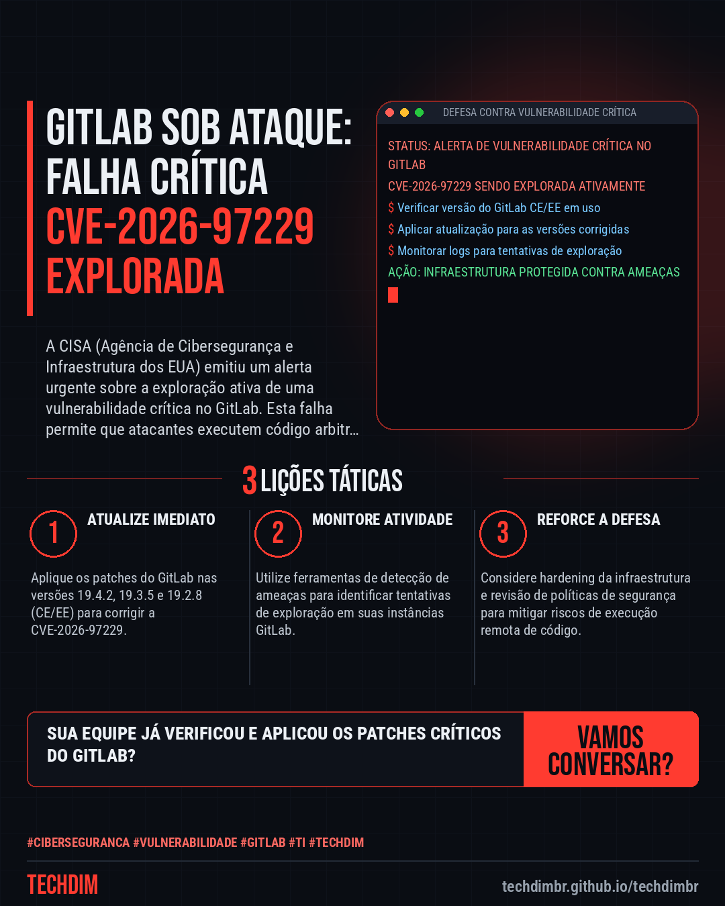

# Cibersegurança · IA · Hacker — Vulnerabilidade GitLab: Falha crítica CVE-2026-97229 é explorada ativamente

- **Data:** 2026-10-30, 16:11 (horário de Brasília)
- **Curadoria:** Claude (Routine) — pauta do dia
- **Execução no Actions:** https://github.com/Techdimbr/Publi-midia-Techdim/actions/runs/41113028454
- **Por que esta pauta:** É crucial alertar sobre vulnerabilidades ativamente exploradas que exigem ação imediata para proteção corporativa.

## Resultado

| Rede | Status | Link | 1º comentário |
|---|---|---|---|
| linkedin | ✅ publicado | https://www.linkedin.com/feed/update/urn:li:share:7522012154057854976/ | — |
| facebook | ✅ publicado | https://www.facebook.com/122132402349390486/posts/122139555537390486 | ✅ |
| instagram | ✅ publicado | https://www.instagram.com/p/DfITXEOF7EJ/ | ✅ |
| Stories | ✅ publicado | https://www.instagram.com/stories/techdimbr/4019547947226572743 | — |

## Fontes

- [bleepingcomputer.com](https://www.bleepingcomputer.com/news/security/hackers-now-exploiting-max-severity-gitlab-flaw-in-attacks/)

## Linkedin

```text
Vulnerabilidade GitLab: Falha crítica CVE-2026-97229 é explorada ativamente

01. CISA confirma exploração ativa da falha crítica CVE-2026-97229 no GitLab, que permite a execução remota de código por atacantes não autenticados.
02. A vulnerabilidade, um overflow de inteiro no compilador de expressões regulares CI/CD, afeta GitLab CE e EE em versões específicas (19.4.2, 19.3.5, 19.2.8).
03. A CISA ordenou agências federais a corrigir até domingo e recomenda que empresas privadas priorizem a aplicação imediata dos patches.

A TECHDIM oferece cibersegurança defensiva para sua infraestrutura, garantindo que vulnerabilidades como esta não comprometam sua operação.

Fontes: https://www.bleepingcomputer.com/news/security/hackers-now-exploiting-max-severity-gitlab-flaw-in-attacks/

TECHDIM — Infraestrutura · Segurança · IA
https://techdimbr.github.io/techdimbr/

#Ciberseguranca #Vulnerabilidade #GitLab #TI #TECHDIM
```



## Facebook

```text
Vulnerabilidade GitLab: Falha crítica CVE-2026-97229 é explorada ativamente

• CISA confirma exploração ativa da falha crítica CVE-2026-97229 no GitLab, que permite a execução remota de código por atacantes não autenticados.
• A vulnerabilidade, um overflow de inteiro no compilador de expressões regulares CI/CD, afeta GitLab CE e EE em versões específicas (19.4.2, 19.3.5, 19.2.8).
• A CISA ordenou agências federais a corrigir até domingo e recomenda que empresas privadas priorizem a aplicação imediata dos patches.

A TECHDIM oferece cibersegurança defensiva para sua infraestrutura, garantindo que vulnerabilidades como esta não comprometam sua operação.

Fale com a TECHDIM — fontes e site no primeiro comentário 👇

#Ciberseguranca #Vulnerabilidade #GitLab #TECHDIM
```

Primeiro comentário:

```text
📎 Fontes:
• bleepingcomputer.com: https://www.bleepingcomputer.com/news/security/hackers-now-exploiting-max-severity-gitlab-flaw-in-attacks/

🌐 TECHDIM — Infraestrutura · Segurança · IA: https://techdimbr.github.io/techdimbr/
```


## Instagram

```text
Vulnerabilidade GitLab: Falha crítica CVE-2026-97229 é explorada ativamente

1️⃣ CISA confirma exploração ativa da falha crítica CVE-2026-97229 no GitLab, que permite a execução remota de código por atacantes não autenticados.
2️⃣ A vulnerabilidade, um overflow de inteiro no compilador de expressões regulares CI/CD, afeta GitLab CE e EE em versões específicas (19.4.2, 19.3.5, 19.2.8).
3️⃣ A CISA ordenou agências federais a corrigir até domingo e recomenda que empresas privadas priorizem a aplicação imediata dos patches.

A TECHDIM oferece cibersegurança defensiva para sua infraestrutura, garantindo que vulnerabilidades como esta não comprometam sua operação.

🔗 Link na bio: techdimbr.github.io/techdimbr
Fontes no primeiro comentário 👇

#ciberseguranca #vulnerabilidade #gitlab #ti #techdim #seguranca #hacker #infraestrutura
```

Primeiro comentário:

```text
📎 Fontes: bleepingcomputer.com
```


## Stories


