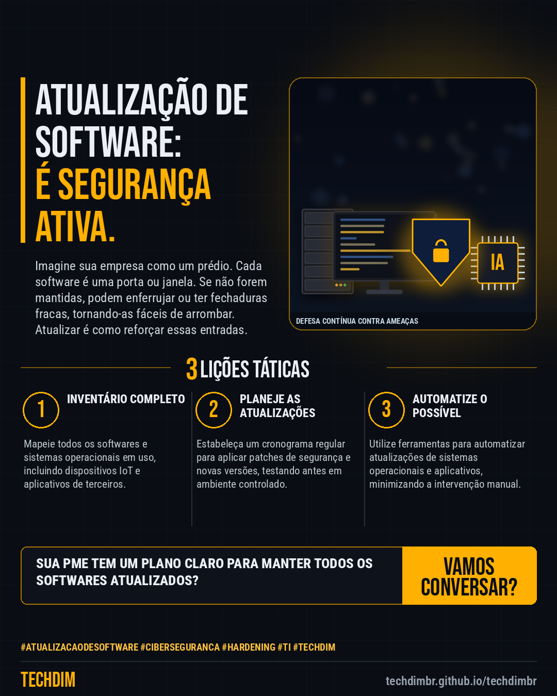

# Conhecimento — Atualização de Software: Controle de segurança essencial para sua PME

- **Data:** 2026-10-30, 18:34 (horário de Brasília)
- **Curadoria:** Claude (Routine) — pauta do dia
- **Execução no Actions:** https://github.com/Techdimbr/Publi-midia-Techdim/actions/runs/41131976727
- **Por que esta pauta:** A atualização de software é uma prática básica, mas frequentemente negligenciada, com grandes impactos na segurança e operação das empresas.

## Resultado

| Rede | Status | Link | 1º comentário |
|---|---|---|---|
| linkedin | ✅ publicado | https://www.linkedin.com/feed/update/urn:li:share:7522048283356073985/ | — |
| facebook | ✅ publicado | https://www.facebook.com/122132402349390486/posts/122139575355390486 | ✅ |
| instagram | ✅ publicado | https://www.instagram.com/p/DfIjyR6F3Z5/ | — |

## Linkedin

```text
Atualização de Software: Controle de segurança essencial para sua PME

01. Software desatualizado é uma porta aberta para ataques. Manter sistemas e aplicativos em dia é a primeira linha de defesa contra vulnerabilidades conhecidas.
02. Muitas atualizações corrigem falhas de segurança críticas que poderiam ser exploradas por cibercriminosos, protegendo dados e a continuidade do negócio.
03. A falta de patches pode levar a incompatibilidades e instabilidade, impactando a produtividade e exigindo intervenções de emergência mais caras.

A TECHDIM ajuda sua empresa a implementar políticas eficazes de atualização, garantindo a segurança e o bom funcionamento da sua infraestrutura.

TECHDIM — Infraestrutura · Segurança · IA
https://techdimbr.github.io/techdimbr/

#AtualizacaoDeSoftware #Ciberseguranca #Hardening #TI #TECHDIM
```



## Facebook

```text
Atualização de Software: Controle de segurança essencial para sua PME

• Software desatualizado é uma porta aberta para ataques. Manter sistemas e aplicativos em dia é a primeira linha de defesa contra vulnerabilidades conhecidas.
• Muitas atualizações corrigem falhas de segurança críticas que poderiam ser exploradas por cibercriminosos, protegendo dados e a continuidade do negócio.
• A falta de patches pode levar a incompatibilidades e instabilidade, impactando a produtividade e exigindo intervenções de emergência mais caras.

A TECHDIM ajuda sua empresa a implementar políticas eficazes de atualização, garantindo a segurança e o bom funcionamento da sua infraestrutura.

Fale com a TECHDIM — link no primeiro comentário 👇

#AtualizacaoDeSoftware #Ciberseguranca #Hardening #TECHDIM
```

Primeiro comentário:

```text
🌐 TECHDIM — Infraestrutura · Segurança · IA: https://techdimbr.github.io/techdimbr/
```


## Instagram

```text
Atualização de Software: Controle de segurança essencial para sua PME

1️⃣ Software desatualizado é uma porta aberta para ataques. Manter sistemas e aplicativos em dia é a primeira linha de defesa contra vulnerabilidades conhecidas.
2️⃣ Muitas atualizações corrigem falhas de segurança críticas que poderiam ser exploradas por cibercriminosos, protegendo dados e a continuidade do negócio.
3️⃣ A falta de patches pode levar a incompatibilidades e instabilidade, impactando a produtividade e exigindo intervenções de emergência mais caras.

A TECHDIM ajuda sua empresa a implementar políticas eficazes de atualização, garantindo a segurança e o bom funcionamento da sua infraestrutura.

🔗 Link na bio: techdimbr.github.io/techdimbr

#atualizacaodesoftware #ciberseguranca #hardening #ti #techdim #conhecimento #aprendati #tecnologia
```


