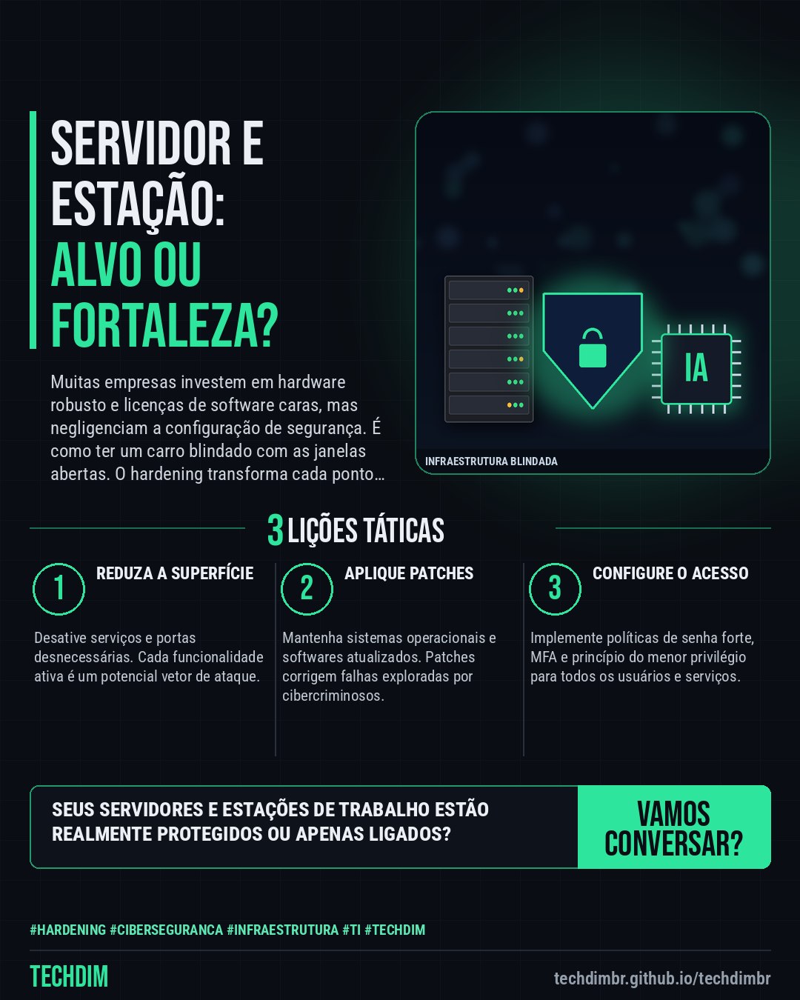

# TECHDIM · Serviços — Hardening de Servidores: Não deixe sua infraestrutura ser um alvo fácil

- **Data:** 2026-10-30, 20:55 (horário de Brasília)
- **Curadoria:** Claude (Routine) — pauta do dia
- **Execução no Actions:** https://github.com/Techdimbr/Publi-midia-Techdim/actions/runs/41147224051
- **Por que esta pauta:** Configurações seguras são a primeira linha de defesa ativa contra invasões.

## Resultado

| Rede | Status | Link | 1º comentário |
|---|---|---|---|
| linkedin | ✅ publicado | https://www.linkedin.com/feed/update/urn:li:share:7522083757030313984/ | — |
| facebook | ✅ publicado | https://www.facebook.com/122132402349390486/posts/122139591243390486 | ✅ |
| instagram | ✅ publicado | https://www.instagram.com/p/DfIz7JJlQS8/ | — |

## Linkedin

```text
Hardening de Servidores: Não deixe sua infraestrutura ser um alvo fácil

01. Servidores e estações com configurações padrão de fábrica ou desatualizadas são portas abertas para ataques cibernéticos, mesmo com antivírus e firewall.
02. Ataques exploram configurações fracas, serviços desnecessários e credenciais padrão para obter acesso inicial, escalar privilégios e comprometer dados.
03. Um processo de hardening sistemático reduz a superfície de ataque, aplicando configurações de segurança robustas e removendo vulnerabilidades conhecidas.

A TECHDIM oferece serviço de hardening de servidores e estações, blindando sua infraestrutura contra as ameaças mais comuns e avançadas.

TECHDIM — Infraestrutura · Segurança · IA
https://techdimbr.github.io/techdimbr/

#Hardening #Ciberseguranca #Infraestrutura #TI #TECHDIM
```



## Facebook

```text
Hardening de Servidores: Não deixe sua infraestrutura ser um alvo fácil

• Servidores e estações com configurações padrão de fábrica ou desatualizadas são portas abertas para ataques cibernéticos, mesmo com antivírus e firewall.
• Ataques exploram configurações fracas, serviços desnecessários e credenciais padrão para obter acesso inicial, escalar privilégios e comprometer dados.
• Um processo de hardening sistemático reduz a superfície de ataque, aplicando configurações de segurança robustas e removendo vulnerabilidades conhecidas.

A TECHDIM oferece serviço de hardening de servidores e estações, blindando sua infraestrutura contra as ameaças mais comuns e avançadas.

Fale com a TECHDIM — link no primeiro comentário 👇

#Hardening #Ciberseguranca #Infraestrutura #TECHDIM
```

Primeiro comentário:

```text
🌐 TECHDIM — Infraestrutura · Segurança · IA: https://techdimbr.github.io/techdimbr/
```


## Instagram

```text
Hardening de Servidores: Não deixe sua infraestrutura ser um alvo fácil

1️⃣ Servidores e estações com configurações padrão de fábrica ou desatualizadas são portas abertas para ataques cibernéticos, mesmo com antivírus e firewall.
2️⃣ Ataques exploram configurações fracas, serviços desnecessários e credenciais padrão para obter acesso inicial, escalar privilégios e comprometer dados.
3️⃣ Um processo de hardening sistemático reduz a superfície de ataque, aplicando configurações de segurança robustas e removendo vulnerabilidades conhecidas.

A TECHDIM oferece serviço de hardening de servidores e estações, blindando sua infraestrutura contra as ameaças mais comuns e avançadas.

🔗 Link na bio: techdimbr.github.io/techdimbr

#hardening #ciberseguranca #infraestrutura #ti #techdim #suportetecnico #automacao #campinas
```


