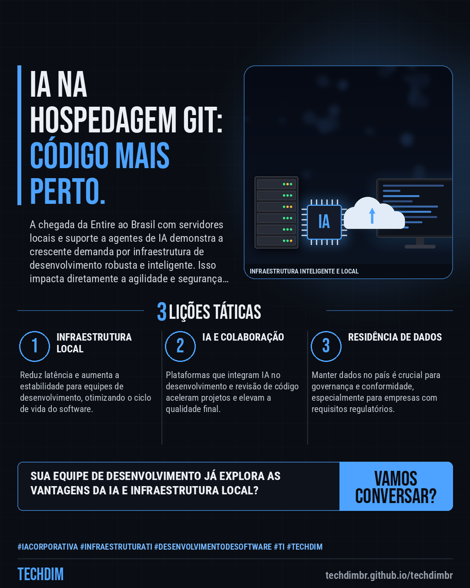
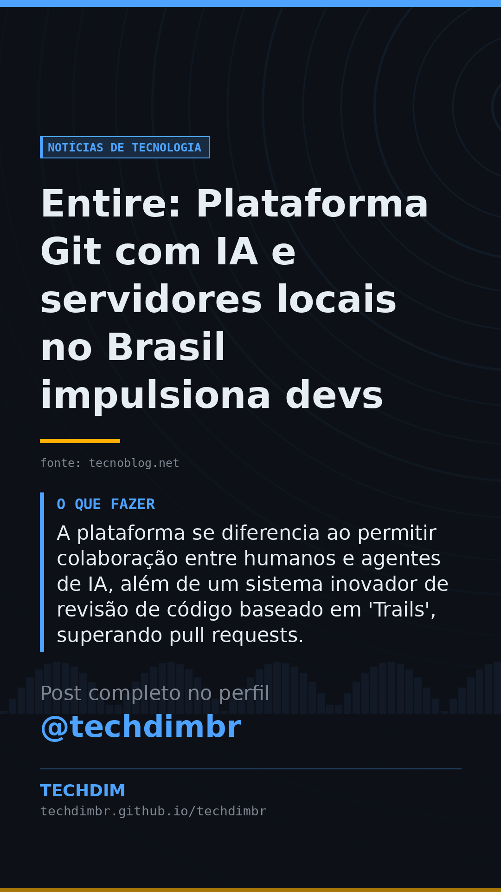

# Notícias de Tecnologia — Entire: Plataforma Git com IA e servidores locais no Brasil impulsiona devs

- **Data:** 2026-10-31, 13:04 (horário de Brasília)
- **Curadoria:** Claude (Routine) — pauta do dia
- **Execução no Actions:** https://github.com/Techdimbr/Publi-midia-Techdim/actions/runs/41217779153
- **Por que esta pauta:** Este assunto é relevante hoje pela expansão de infraestrutura de desenvolvimento e IA no Brasil, impactando a gestão de projetos de software.

## Resultado

| Rede | Status | Link | 1º comentário |
|---|---|---|---|
| linkedin | ✅ publicado | https://www.linkedin.com/feed/update/urn:li:share:7522327451335835649/ | — |
| facebook | ✅ publicado | https://www.facebook.com/122132402349390486/posts/122139738171390486 | ✅ |
| instagram | ✅ publicado | https://www.instagram.com/p/DfKivXPDr60/ | ✅ |
| Stories | ✅ publicado | https://www.instagram.com/stories/techdimbr/4020178521573734037 | — |

## Fontes

- [tecnoblog.net](https://tecnoblog.net/noticias/entire-do-ex-ceo-do-github-ja-hospeda-codigos-no-brasil/)

## Linkedin

```text
Entire: Plataforma Git com IA e servidores locais no Brasil impulsiona devs

01. A Entire, nova plataforma de hospedagem Git do ex-CEO do GitHub, Thomas Dohmke, expandiu operações para o Brasil com infraestrutura de servidores locais.
02. Projetos de desenvolvedores brasileiros agora podem ser hospedados localmente, garantindo mais estabilidade, menor latência e opção de residência de dados no país.
03. A plataforma se diferencia ao permitir colaboração entre humanos e agentes de IA, além de um sistema inovador de revisão de código baseado em 'Trails', superando pull requests.

A evolução das plataformas com IA e infraestrutura local reforça a necessidade de otimizar sua TI e governança de dados.

Fontes: https://tecnoblog.net/noticias/entire-do-ex-ceo-do-github-ja-hospeda-codigos-no-brasil/

TECHDIM — Infraestrutura · Segurança · IA
https://techdimbr.github.io/techdimbr/

#IACorporativa #InfraestruturaTI #DesenvolvimentoDeSoftware #TI #TECHDIM
```



## Facebook

```text
Entire: Plataforma Git com IA e servidores locais no Brasil impulsiona devs

• A Entire, nova plataforma de hospedagem Git do ex-CEO do GitHub, Thomas Dohmke, expandiu operações para o Brasil com infraestrutura de servidores locais.
• Projetos de desenvolvedores brasileiros agora podem ser hospedados localmente, garantindo mais estabilidade, menor latência e opção de residência de dados no país.
• A plataforma se diferencia ao permitir colaboração entre humanos e agentes de IA, além de um sistema inovador de revisão de código baseado em 'Trails', superando pull requests.

A evolução das plataformas com IA e infraestrutura local reforça a necessidade de otimizar sua TI e governança de dados.

Fale com a TECHDIM — fontes e site no primeiro comentário 👇

#IACorporativa #InfraestruturaTI #DesenvolvimentoDeSoftware #TECHDIM
```

Primeiro comentário:

```text
📎 Fontes:
• tecnoblog.net: https://tecnoblog.net/noticias/entire-do-ex-ceo-do-github-ja-hospeda-codigos-no-brasil/

🌐 TECHDIM — Infraestrutura · Segurança · IA: https://techdimbr.github.io/techdimbr/
```


## Instagram

```text
Entire: Plataforma Git com IA e servidores locais no Brasil impulsiona devs

1️⃣ A Entire, nova plataforma de hospedagem Git do ex-CEO do GitHub, Thomas Dohmke, expandiu operações para o Brasil com infraestrutura de servidores locais.
2️⃣ Projetos de desenvolvedores brasileiros agora podem ser hospedados localmente, garantindo mais estabilidade, menor latência e opção de residência de dados no país.
3️⃣ A plataforma se diferencia ao permitir colaboração entre humanos e agentes de IA, além de um sistema inovador de revisão de código baseado em 'Trails', superando pull requests.

A evolução das plataformas com IA e infraestrutura local reforça a necessidade de otimizar sua TI e governança de dados.

🔗 Link na bio: techdimbr.github.io/techdimbr
Fontes no primeiro comentário 👇

#iacorporativa #infraestruturati #desenvolvimentodesoftware #ti #techdim #tecnologia #inteligenciaartificial #ia
```

Primeiro comentário:

```text
📎 Fontes: tecnoblog.net
```


## Stories


